# Phase1.2 实体关系 ER 图

> 说明：下图以 Mermaid `erDiagram` 表述 Phase 1.2 统一数据模型的**核心实体关系**。基数经 Mermaid 语法转为显式；`source_reference`/`object_link`/`object_dimension_tag` 三张"多态桥表"以多态引用覆盖"各类对象↔来源/对象↔对象/对象↔维度"的 M:N，避免画面上无限发散。
> 图中"PFK"表示多态引用（`type + id` 双字段），非硬外键（实现细节见《数据库表结构设计》）。

```mermaid
erDiagram
    PROJECT ||--o{ PROJECT_PHASE : "has 1:N"
    PROJECT ||--o{ PROJECT_MEMBER : "member-of 1:N"
    ORGANIZATION ||--o{ PERSON : "employs 1:N"
    ORGANIZATION ||--o{ PROJECT_MEMBER : "participates 1:N"
    PERSON ||--o{ PROJECT_MEMBER : "takes-roles 1:N"

    PROJECT ||--o{ PROJECT_DISCIPLINE : "applies 1:N"
    DISCIPLINE ||--o{ PROJECT_DISCIPLINE : "in 1:N"
    PROJECT ||--o{ PROJECT_AREA : "applies 1:N"
    AREA ||--o{ PROJECT_AREA : "in 1:N"
    PROJECT ||--o{ PROJECT_SYSTEM : "applies 1:N"
    SYSTEM ||--o{ PROJECT_SYSTEM : "in 1:N"
    PROJECT ||--o{ PROJECT_EQUIPMENT : "applies 1:N"
    EQUIPMENT ||--o{ PROJECT_EQUIPMENT : "in 1:N"

    EQUIPMENT_CATEGORY ||--o{ EQUIPMENT : "categorizes 1:N"
    SYSTEM ||--o{ EQUIPMENT : "contains 1:N"
    EQUIPMENT ||--o{ PROJECT_EQUIPMENT : "scoped 1:N"

    PROJECT ||--o{ PLAN : "has 1:N"
    PLAN ||--o{ PLAN_VERSION : "versioned 1:N"
    PLAN ||--o{ BASELINE_VERSION : "baselined 1:N"
    PLAN ||--o{ PLAN_ACTIVITY : "contains 1:N"
    PLAN_VERSION ||--o{ BASELINE_VERSION : "guards 1:N"
    PLAN_ACTIVITY ||--o{ ACTIVITY_DEPENDENCY : "predecessor 1:N"
    PLAN_ACTIVITY ||--o{ ACTIVITY_DEPENDENCY : "successor 1:N"
    PLAN_ACTIVITY ||--o{ PROGRESS_RECORD : "tracks 1:N"

    EMAIL ||--o{ EMAIL_ATTACHMENT : "has 1:N"
    DOCUMENT ||--o{ DOCUMENT_VERSION : "has 1:N"
    DRAWING ||--o{ DRAWING_VERSION : "has 1:N"
    DRAWING ||--o{ DRAWING_OBJECT : "objects 1:N"
    MEETING ||--o{ MEETING_MINUTES : "produced 1:N"

    PROJECT ||--o{ ISSUE : "has 1:N"
    ISSUE ||--o{ ISSUE_STATUS_HISTORY : "history 1:N"
    PROJECT ||--o{ RISK : "has 1:N"
    RISK ||--o{ RISK_STATUS_HISTORY : "history 1:N"
    PROJECT ||--o{ TASK : "has 1:N"
    TASK ||--o{ TASK_STATUS_HISTORY : "history 1:N"
    RISK ||--o{ ACTION_MEASURE : "response 1:N"
    ISSUE ||--o{ ACTION_MEASURE : "remedy 1:N"

    ENTITY ||--o{ ENTITY_ALIAS : "alias-of 1:N"
    ENTITY ||--o{ ENTITY_IDENTIFIER : "identifies 1:N"
    ENTITY ||--o{ ENTITY_RELATIONSHIP : "rel-left 1:N"
    ENTITY ||--o{ ENTITY_RELATIONSHIP : "rel-right 1:N"
    ENTITY ||--o{ ENTITY : "canonical merge N:1"

    KNOWLEDGE_ITEM ||--o{ KNOWLEDGE_VERSION : "versioned 1:N"
    KNOWLEDGE_VERSION ||--o{ KNOWLEDGE_ENTITY_LINK : "touches 1:N"
    ENTITY ||--o{ KNOWLEDGE_ENTITY_LINK : "linked 1:N"

    INGESTION_JOB ||--o{ EXTRACTION_RESULT : "produces 1:N"
    EXTRACTION_RESULT ||--o{ REVIEW_QUEUE : "queued 1:N"
    USER ||--o{ USER_ROLE : "has 1:N"
    ROLE ||--o{ USER_ROLE : "has 1:N"
    ROLE ||--o{ ROLE_PERMISSION : "has 1:N"
    PERMISSION ||--o{ ROLE_PERMISSION : "assigned 1:N"

    %% 多态桥表（M:N via 多态引用，见下方图注）
    %% SOURCE_REFERENCE }o--o{ (_ANY_OBJECT) : "traces"
    %% OBJECT_LINK }o--o{ (_ANY_OBJECT) : "relates"
    %% OBJECT_DIMENSION_TAG }o--o{ (_ANY_OBJECT) : "tags"
```



## 图注与基数澄清

1. **项目→组织 为 M:N**：经 `project_member`（项目×组织×角色三维）实现；画面简化为 `PROJECT--PROJECT_MEMBER--ORGANIZATION`（两段 1:N）。
2. **Issue↔ 计划活动/邮件/文档/会议/会议纪要/消息/证据 全部 M:N**：统一经 `object_link`（业务对象间）与 `source_reference`（业务对象↔来源载体）桥接；画面不逐对展开（见 ADR-4/ADR-5）。
3. **一个文件被多个事项引用 M:N**：经 `source_reference` 多对多，文件端只读不可反向篡改（B.4）。
4. **Issue→Issue = 合并链**：在 B.5 中落到 `entity`（全局实体标识）经 `entity_relationship(synonym/merge)` 表达；`issue` 本身不直接自引用合并。
5. **Decision/Evidence 挂任意对象**：经 `decision_link`/`evidence_link` 多态引用，画面以对象桥覆盖。
6. **BaseLine 只读**：`baseline_version.is_readonly` 触发器强拦 + 应用层 + 审计（OQ-3）。

---

### 多态桥表图例（本图之外的三组全链路 M:N）

```
[A.3] 来源域对象(邮件/附件/文档/图纸/会议纪要/消息/证据)
   │            source_reference (SOURCE)
   ▼
任意业务实体(issue/risk/task/decision/knowledge/activity/entity/…)
   —— 多态双字段 traced_entity_type + traced_entity_id

[任意对象A]  object_link  [任意对象B]
   —— 多态 left_type+left_id / right_type+right_id，M:N，带 link_role + context_excerpt

[任意对象]   object_dimension_tag   (EPCS_PHASE | DISCIPLINE | AREA | SYSTEM)
   —— 被打标签对象 + dimension + value_id / value_text，可并列/跨阶段（B.2）
```