# Phase1.2 实体关系 ER 图（R1 整改同步）

> 说明：下图以 Mermaid `erDiagram` 表述 Phase 1.2 统一数据模型的**核心实体关系**，覆盖 R1 的 **75 张实体表**的主要关系。基数经 Mermaid 语法转为显式；`source_reference` / `object_link` / `object_dimension_tag` 等"多态桥表"以多态引用覆盖"各类对象↔来源 / 对象↔对象 / 对象↔维度"的 M:N，避免画面上无限发散。
> 图中"PFK"表示多态引用（`type + id` 双字段），**非硬外键**（实现细节与自检策略见《数据库表结构设计》§7.6）。
> R1 整改同步：2026-11-12，以《Phase1.2_数据库表结构设计.md》(R1) 为唯一真值源
> 统计口径（8 份文档一致）：实体表 **75**（业务主表 46 + 辅助 29）、FTS5 虚表 **24**、触发器 **96**、视图 **0**。`schema_version` 为独立元信息表，无业务关系，图中以注释标出。

```mermaid
erDiagram
    PROJECT ||--o{ PROJECT_PHASE : "has 1:N"
    PROJECT ||--o{ PROJECT_MEMBER : "member-of 1:N"
    ORGANIZATION ||--o{ PERSON : "employs 1:N"
    ORGANIZATION ||--o{ PROJECT_MEMBER : "participates 1:N"
    PERSON ||--o{ PROJECT_MEMBER : "takes-roles 1:N"
    ORGANIZATION ||--o{ DEPARTMENT : "has 1:N"
    DEPARTMENT ||--o{ DEPARTMENT : "parent 1:N"
    DEPARTMENT ||--o{ PERSON : "employs 1:N"

    PROJECT ||--o{ PROJECT_DISCIPLINE : "applies 1:N"
    DISCIPLINE ||--o{ PROJECT_DISCIPLINE : "in 1:N"
    PROJECT ||--o{ PROJECT_AREA : "applies 1:N"
    AREA ||--o{ PROJECT_AREA : "in 1:N"
    PROJECT ||--o{ PROJECT_SYSTEM : "applies 1:N"
    SYSTEM ||--o{ PROJECT_SYSTEM : "in 1:N"
    PROJECT ||--o{ PROJECT_EQUIPMENT : "applies 1:N"
    EQUIPMENT ||--o{ PROJECT_EQUIPMENT : "in 1:N"
    EQUIPMENT_CATEGORY ||--o{ EQUIPMENT : "categorizes 1:N"
    SYSTEM ||--o{ EQUIPMENT : "contains 1:N"
    ENTITY ||--o{ PROJECT : "main-object 1:N"
    ENTITY ||--o{ EQUIPMENT : "manufacturer 1:N"

    PROJECT ||--o{ PLAN : "has 1:N"
    PLAN ||--o{ PLAN_VERSION : "versioned 1:N"
    PLAN ||--o{ BASELINE_VERSION : "baselined 1:N"
    PLAN ||--o| PLAN_ACTIVE_BASELINE : "current 1:1"
    PLAN ||--o{ BASELINE_SWITCH_LOG : "switch-history 1:N"
    BASELINE_VERSION ||--o| PLAN_ACTIVE_BASELINE : "pointed-by 1:1"
    PLAN_VERSION ||--o{ BASELINE_VERSION : "guards 1:N"
    PLAN ||--o{ PLAN_ACTIVITY : "contains 1:N"
    PLAN_VERSION ||--o{ PLAN_ACTIVITY_VERSION : "snapshot 1:N"
    PLAN_ACTIVITY ||--o{ PLAN_ACTIVITY_VERSION : "versioned 1:N"
    PLAN_VERSION ||--o{ ACTIVITY_DEPENDENCY : "scoped 1:N"
    PLAN_ACTIVITY ||--o{ ACTIVITY_DEPENDENCY : "predecessor 1:N"
    PLAN_ACTIVITY ||--o{ ACTIVITY_DEPENDENCY : "successor 1:N"
    PLAN_ACTIVITY ||--o{ PROGRESS_RECORD : "tracks 1:N"
    PLAN_VERSION ||--o{ PROGRESS_RECORD : "compared 1:N"

    EMAIL ||--o{ EMAIL_ATTACHMENT : "has 1:N"
    DOCUMENT ||--o{ DOCUMENT_VERSION : "has 1:N"
    DRAWING ||--o{ DRAWING_VERSION : "has 1:N"
    DRAWING ||--o{ DRAWING_OBJECT : "objects 1:N"
    MEETING ||--o{ MEETING_MINUTES : "produced 1:N"

    BUSINESS_SUBJECT ||--o{ BUSINESS_SUBJECT_ALIAS : "alias 1:N"
    BUSINESS_SUBJECT ||--o{ BUSINESS_SUBJECT_MERGE : "merge-from 1:N"
    BUSINESS_SUBJECT ||--o{ BUSINESS_SUBJECT_MERGE : "merge-to 1:N"
    BUSINESS_SUBJECT ||--o{ BUSINESS_SUBJECT_SOURCE : "evidence 1:N"
    BUSINESS_SUBJECT ||--o| BUSINESS_SUBJECT : "canonical N:1"
    BUSINESS_SUBJECT ||--o| ISSUE : "subject 1:1"
    BUSINESS_SUBJECT ||--o| RISK : "subject 1:1"
    BUSINESS_SUBJECT ||--o| TASK : "subject 1:1"
    BUSINESS_SUBJECT ||--o| DECISION : "subject 1:1"
    BUSINESS_SUBJECT ||--o| KNOWLEDGE_ITEM : "subject 1:1"

    PROJECT ||--o{ ISSUE : "has 1:N"
    ISSUE ||--o{ ISSUE_STATUS_HISTORY : "history 1:N"
    PROJECT ||--o{ RISK : "has 1:N"
    RISK ||--o{ RISK_STATUS_HISTORY : "history 1:N"
    PROJECT ||--o{ TASK : "has 1:N"
    TASK ||--o{ TASK_STATUS_HISTORY : "history 1:N"
    RISK ||--o{ ACTION_MEASURE : "response 1:N"
    ISSUE ||--o{ ACTION_MEASURE : "remedy 1:N"
    ACTION_MEASURE ||--o{ ACTION_MEASURE_LINK : "owner 1:N"
    DECISION ||--o{ DECISION_LINK : "attached 1:N"
    EVIDENCE ||--o{ EVIDENCE_LINK : "attached 1:N"

    ENTITY ||--o{ ENTITY_ALIAS : "alias-of 1:N"
    ENTITY ||--o{ ENTITY_IDENTIFIER : "identifies 1:N"
    ENTITY ||--o{ ENTITY_RELATIONSHIP : "rel-left 1:N"
    ENTITY ||--o{ ENTITY_RELATIONSHIP : "rel-right 1:N"
    ENTITY ||--o{ ENTITY : "canonical-merge-entities-only N:1"

    KNOWLEDGE_ITEM ||--o{ KNOWLEDGE_VERSION : "versioned 1:N"
    KNOWLEDGE_VERSION ||--o{ KNOWLEDGE_ENTITY_LINK : "touches 1:N"
    ENTITY ||--o{ KNOWLEDGE_ENTITY_LINK : "linked 1:N"

    INGESTION_JOB ||--o{ EXTRACTION_RESULT : "produces 1:N"
    REVIEW_QUEUE ||--o{ REVIEW_EXTRACTION_LINK : "links 1:N"
    EXTRACTION_RESULT ||--o{ REVIEW_EXTRACTION_LINK : "linked 1:N"
    REVIEW_QUEUE ||--o{ REVIEW_DECISION : "decided 1:N"
    REVIEW_DECISION ||--o{ REVIEW_RESULT_OBJECT : "produces 1:N"

    USER ||--o{ USER_ROLE : "has 1:N"
    ROLE ||--o{ USER_ROLE : "has 1:N"
    ROLE ||--o{ ROLE_PERMISSION : "has 1:N"
    PERMISSION ||--o{ ROLE_PERMISSION : "assigned 1:N"

    %% SCHEMA_VERSION : 独立元信息表（迁移版本 + ddl_fingerprint），无业务关系
    %% 多态桥表（M:N via 多态引用，见下方图注）
    %% SOURCE_REFERENCE }o--o{ (_ANY_OBJECT) : "traces"
    %% OBJECT_LINK }o--o{ (_ANY_OBJECT) : "relates"
    %% OBJECT_DIMENSION_TAG }o--o{ (_ANY_OBJECT) : "tags"
```



## 图注与基数澄清（R1）

1. **项目→组织 为 M:N**：经 `project_member`（项目×组织×角色三维）实现；画面简化为 `PROJECT--PROJECT_MEMBER--ORGANIZATION`（两段 1:N）。新增 `department`（`organization` 1:N、自关联 `parent_id`、`person.department_id` 可空 FK），与 `organization.parent_id`（上下级单位）职责分离。
2. **Issue↔ 计划活动/邮件/文档/会议/会议纪要/消息/证据 全部 M:N**：统一经 `object_link`（业务对象间）与 `source_reference`（业务对象↔来源载体）桥接；画面不逐对展开（见 ADR-4 / ADR-5）。
3. **一个文件被多个事项引用 M:N**：经 `source_reference` 多对多，文件端只读不可反向篡改（B.4）；`context_excerpt` + `locator` 记录"引了哪段/哪图"。
4. **Issue→Issue = 合并链（原图注作废，R1 改写）**：原稿写「落到 `entity` 经 `entity_relationship(synonym/merge)` 表达，`issue` 本身不直接自引用合并」，混淆了**业务实体**与**业务事项**，已作废。R1 改为：`business_subject`（统一事项主档）+ `business_subject_alias`（一事项多别名）+ `business_subject_merge`（**可逆合并链**，`undone_at` / `undone_by` / `undo_reason` / `is_active=0`）+ `business_subject_source`（事项↔来源证据 M:N）；`issue/risk/task/decision/knowledge_item` 各以 `subject_id TEXT NOT NULL UNIQUE` 1:1 挂到 `business_subject`。合并后**原业务记录不删除、不覆盖**，仅标 `status=MERGED` 并保留 `canonical_subject_id`，历史引用经 canonical 链可回放。**明确：`entity_relationship` 只表达业务实体（设备/船舶/区域/组织/供应商）的语义关系，不得承载业务事项合并。**
5. **Decision / Evidence 挂任意对象**：经 `decision_link` / `evidence_link` 多态引用；`action_measure` 另有 `action_measure_link` 支持一个措施挂多个属主（M:N）。
6. **基线只读（原图注作废，R1 改写）**：不再是「`baseline_version.is_readonly` 触发器强拦」的简略说法。改为**状态分离 + 四层防御**：删除 `UNIQUE(plan_id,is_active)` 与 `baseline_version.is_active`；新增 `plan_active_baseline`（当前生效指针，部分唯一索引 `uq_pab_active`）+ `baseline_switch_log`（切换授权审计）；`baseline_version` 由无差别 `BEFORE UPDATE/DELETE ... WHEN OLD.is_readonly=1 → RAISE(ABORT)` **全字段冻结**；切换为应用层单事务、全程不触碰基线行；再加应用层写入白名单与 `audit_log` 审计。
7. **计划活动版本化与历史回放（R1 新增）**：`plan_activity` 为稳定主实体，`plan_activity_version` 为每版本属性快照（`change_type` ∈ ADDED/MODIFIED/UNCHANGED/REMOVED）；`baseline_version.plan_version_id` 指向完整计划版本，故可按 `baseline → plan_version → plan_activity_version` 回放批准计划、做 V1/V2 差异与滚动预测对比。
8. **审核四表链（R1 新增）**：`review_queue`（纯审核任务）↔ `extraction_result` 经 `review_extraction_link` 建立 **M:N**（原图 `EXTRACTION_RESULT ||--o{ REVIEW_QUEUE` 直连已删除）；`review_queue` → `review_decision`（含审核人/时间/理由/证据）→ `review_result_object`（→ 7 类正式对象稳定映射）。支持一条抽取拆多对象、多条抽取合一对象；原始抽取由 `trg_er_immutable_u/d` 保护，审核后不得删除或覆盖。
9. **多态引用的完整性（已知取舍）**：`source_reference` / `object_link` / `evidence_link` / `decision_link` / `action_measure_link` / `review_result_object` / `business_subject_alias` / `object_dimension_tag` 用 `type + id` 双字段，**无硬 FK**；由 `sp_check_polymorphic_refs`（按 type 分派的 UNION 孤儿查询，摄入后 + 定期执行，结果写 `audit_log`）+ 应用层校验 + 审计三层补偿，不伪装成数据库硬约束。
10. **FTS5 与软删**：24 张 trigram 虚表与内容表一一对应，索引全部历史版本；软删保留 FTS 行、仅 `is_deleted` 镜像置 1，查询带 `AND is_deleted=0` 并 JOIN 主表二次过滤。详见《数据库表结构设计》§7。

---

### 多态桥表图例（本图之外的全链路 M:N）

```
[A.3] 来源域对象(邮件/附件/文档/图纸/会议纪要/消息/证据)
   │            source_reference (SOURCE)
   ▼
任意业务对象(issue/risk/task/decision/knowledge/activity/entity/business_subject/…)
   —— 多态双字段 traced_entity_type + traced_entity_id

[任意对象A]  object_link  [任意对象B]
   —— 多态 left_type+left_id / right_type+right_id，M:N，带 link_role + context_excerpt

[任意对象]   object_dimension_tag   (EPCS_PHASE | DISCIPLINE | AREA | SYSTEM)
   —— 被打标签对象 + dimension + value_type(REF|FREE_TEXT) + value_id / value_text，可并列/跨阶段（B.2）
```

---

### 75 张表覆盖核对（与《核心实体数据字典》§0.4、《数据库表结构设计》§0.4 一致）

| 域 | 表数 | 本图覆盖要点 |
|---|---|---|
| 1 项目与组织 | 15 | `project` / `project_phase` / `organization` / **`department`** / `person` / `project_member` / 4 张 `project_*` 关联 / 维度与设备表；两处 `entity` 显式 FK |
| 2 计划管理 | 9 | `plan` / `plan_version` / `baseline_version` / **`plan_active_baseline`** / **`baseline_switch_log`** / `plan_activity` / **`plan_activity_version`** / `activity_dependency` / `progress_record` |
| 3 信息与文件 | 13 | 邮件/文档/图纸/会议/纪要/消息/来源/证据及其版本与 link 表 |
| 4 问题/风险/任务闭环 | 15 | **`business_subject` 四表** + issue/risk/task 及状态历史 + `action_measure` / `decision` / `object_link` / 各 link |
| 5 实体关系与知识 | 7 | `entity` 四表 + `knowledge_item` / `knowledge_version` / `knowledge_entity_link` |
| 6 AI 处理与系统治理 | 15 | `schema_version`（注释标出）/ `ingestion_job` / `extraction_result` / **`review_*` 四表** / `audit_log` / `system_config` / 权限骨架 5 表 |
| 7 共享桥表 | 1 | `object_dimension_tag`（多态桥，图例说明） |
| **合计** | **75** | A 业务主表 46 + B 辅助 29，与真值源零差异 |

---

## R1 整改同步说明（2026-11-12）

| # | 位置 | 改动点 |
|---|---|---|
| 1 | 顶部说明 | 加「R1 整改同步」标注、75 张表覆盖声明与统一统计口径 75 / 24 / 96 / 0 |
| 2 | Mermaid 图 | 新增 `department`、`plan_active_baseline`、`baseline_switch_log`、`plan_activity_version`、`business_subject` 四表、`review_*` 四表、`action_measure_link` / `decision_link` / `evidence_link` 等关系；补两处 `entity` 显式 FK |
| 3 | Mermaid 图 | **删除** `EXTRACTION_RESULT ||--o{ REVIEW_QUEUE` 直连，改为经 `REVIEW_EXTRACTION_LINK` 的 M:N；`ENTITY ||--o{ ENTITY` 保留但标注「仅业务实体归一」 |
| 4 | 图注 4 | **原结论作废**，改为 `business_subject` + 可逆 `business_subject_merge` 双层归一，明确 `entity_relationship` 不得承载事项合并 |
| 5 | 图注 6 | **原结论作废**，改为状态分离 + 四层防御 + 全字段冻结 |
| 6 | 新增图注 7~10 | 计划活动版本化与回放、审核四表链、多态引用三层补偿、FTS 软删镜像 |
| 7 | 文末 | 新增「75 张表覆盖核对」简表与本节同步说明 |

> 本图只表达**主要关系与基数**；完整字段、约束、索引、触发器与 FTS 一一对应以《Phase1.2_数据库表结构设计.md》(R1) 为唯一真值源。
