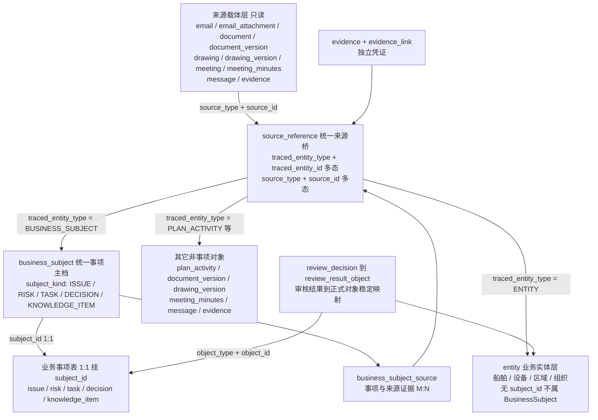

# Phase1.2 数据来源与证据追溯规范

> **版本：R2**（Phase 1.2 复审「数据模型完整性与证据追溯」定向整改后）｜日期：2026-11-12
> **R2 承接说明**：本文件已按 R2 复审结论同步修订，唯一真值源为《Phase1.2_数据库表结构设计.md》(**R2**)；统一统计口径 **实体表 75 / FTS5 虚表 24 / 触发器 126 / 视图 0**（R1 的「触发器 96」已作废）。R2 仅针对 7 项阻断（P1~P7）+ 4 项实现边界（B1~B4）定向整改，不全面重做 Phase 1.2。
> **命名声明（P6）**：`check_polymorphic_refs` 是**应用层执行的一组 SQL 自检语句集**，SQLite **没有原生存储过程**、不能 `CALL`；R1 的 `sp_` 前缀命名已全文废弃，全文统一为新名。

> R1 整改同步：2026-11-12（**R1 时点历史记录**）；当前唯一真值源为《Phase1.2_数据库表结构设计.md》(**R2**)，统计口径见上方「R2 承接说明」。
> 目标：落实 G2（来源可追溯）与 B.4（文件只读事实源，可被多事项引用）的统一机制，避免各表各自造"来源"字段。本规范定义 `SourceReference`、`Evidence`、`IngestionJob→ExtractionResult` 全链路追溯，以及"来源引用"的分层与去重。

---

## 1. 三层追溯模型（R2-P4 重写：Entity 与 BusinessSubject 双层分界）

> **【R1 表述作废】** R1 §1 把业务事实层写成「`business_subject → issue / risk / task / decision / plan_activity / knowledge_item / entity`（具体事项 1:1 挂 `subject_id`）」，与 SQL **不符**：`plan_activity` 与 `entity` **都没有 `subject_id`**，`business_subject.subject_kind` 的 CHECK 枚举也不含 `ENTITY` / `PLAN_ACTIVITY`。R2 保留 R1 已正确建立的**双层结构**（**不把 Entity 变成 BusinessSubject**），按两条互不混淆的追溯通道重写本节文字与流程图；ER 图、数据字典、真值源 §4/§5 均与此一致。



**双层结构与两条追溯通道（R2 定案）**：
1. **业务事项层**（事件：Issue / Risk / Task / Decision / KnowledgeItem）：`issue / risk / task / decision / knowledge_item` 各自以 `subject_id TEXT NOT NULL UNIQUE REFERENCES business_subject(id)` **1:1** 挂到 `business_subject`；再经 `business_subject_source`（M:N，保留每一次出现位置）→ `source_reference` → 来源载体。**只有这 5 类对象有 `subject_id`**。
2. **业务实体层**（名词：船舶 / 设备 / 区域 / 组织 / 供应商）：`entity` **不挂 `subject_id`、不是 BusinessSubject**，其来源直接由 `source_reference.traced_entity_type='ENTITY' + traced_entity_id` 追溯；别名 / 外部编号 / 实体关系分别由 `entity_alias` / `entity_identifier` / `entity_relationship` 承载，且各自也带 `source_reference_id`。
3. **其它非事项对象**：`plan_activity`、`document_version`、`drawing_version`、`meeting_minutes`、`message`、`evidence` 等同样**不经 `business_subject`**，由 `source_reference` 的多态 `traced_entity_type + traced_entity_id` 直接追溯（合法 type 值见 §2 与真值源 §7.6.2）。
4. **审核链通道**：`review_decision`（**R2-P3：证据 `NOT NULL` + FK + 触发器**）→ `review_result_object`（7 类 `object_type` 稳定映射）→ 正式对象；审核决定本身必须有来源证据，不得为空。

**规则**：
- 原始载体（邮件正文/文档正文/图纸）只读，只能软删/版本化，不可反向篡改（B.4）。
- 业务事实都必须能至少通过一条 **G2 追溯通道** 定位到来源：通道 A（业务事项：`business_subject_source` + `source_reference`）、通道 B（业务实体 / 其它对象：`source_reference` 直接多态追溯）、通道 C（`review_result_object` 审核结果→正式对象稳定映射）；覆盖率由 `check_polymorphic_refs` 自检 SQL 核验（《数据库表结构设计》§7.6.2）。
- 派生结论（knowledge）需要"证据链"支撑：`source_reference`（原文）+ `evidence_link`（凭证）+ `business_subject_merge`（事项合并判据）/ `business_subject_source`（事项来源证据）。
- **R1-4 更正（继续有效）**：`entity_relationship` 仅表达业务实体（设备/船舶/组织/专业…）之间的语义关系（同义、整机-部件），**不得**承载 Issue/Risk/Task 等业务事项的合并判据；事项合并一律走 `business_subject_merge`（R2-P7 已为其加数据库级守卫）。

---

## 2. `source_reference` 设计要点

| 字段 | 语义 | 说明 |
|---|---|---|
| traced_entity_type / traced_entity_id | 被溯源对象 | 多态（**R2-P6 统一大写**）：`ISSUE / RISK / TASK / DECISION / KNOWLEDGE_ITEM / ACTION_MEASURE / BUSINESS_SUBJECT / ENTITY / PLAN_ACTIVITY / PLAN_VERSION / BASELINE_VERSION / DOCUMENT / DRAWING / EVIDENCE`，完整合法值 → 目标表映射见真值源 §7.6.2 |
| source_type / source_id | 来源载体 | 多态（**R2-P6 统一大写**）：`EMAIL / EMAIL_ATTACHMENT / DOCUMENT / DOCUMENT_VERSION / DRAWING / DRAWING_VERSION / MEETING / MEETING_MINUTES / MESSAGE / EVIDENCE`；明确纳入 `document_version` / `drawing_version` / `meeting_minutes` / `message` 等历史版本与消息类型 |
| context_excerpt | 上下文摘录 | "引用了哪一段/哪张图"，便于回溯；可行时存剪贴内容 |
| locator | 定位 | 段落号/图号/pin/行号 |
| info_nature | 溯源关系事实级别 | 默认 SOURCE_FACT |
| confidence | 置信度 | AI 抽取时给出，人工确认可改为 1.0 |

**为什么要多态而非硬外键**：来源载体与被溯源实体分属不同表，且未来不断新增类型（如未来 DWG 图纸对象）；多态避免"新增来源类型就加一列外键"。代价是缺 FK 完整性，由应用层 + `AuditLog` + 摄入后校验兜底（ADR-6）。

**R2-P6 定案：`check_polymorphic_refs`（应用层 SQL 自检语句集，非存储过程，非硬 FK）**：
- **醒目声明**：SQLite **没有原生存储过程**；`check_polymorphic_refs` 不是存储过程、不能 `CALL`，而是由应用层执行的一组 SQL 语句集。R1 的 `sp_` 前缀命名会误导开发人员，已全文统一改名。
- **完整映射**：`引用字段 → 合法 type 值 → 目标表 → 自检 SQL` 覆盖**全部 8 类多态引用 / 10 个检测分支**（`object_link` 左右两侧、`source_reference` 的 traced/source、`evidence_link`、`decision_link`、`action_measure_link`、`review_result_object`、`business_subject_alias`、`object_dimension_tag`），目标表全集 23 类，明确证明 `document_version` / `drawing_version` / `meeting_minutes` / `message` / `risk` / `task` / `knowledge_item` 等合法类型均可被检查。完整可执行 SQL（`WITH target AS ...` + `LEFT JOIN ... IS NULL` 反连接，不是 `NOT IN`）见《数据库表结构设计》§7.6.2。
- **R2 type 值统一大写**（与 `review_result_object.object_type` / `business_subject.subject_kind` 的 CHECK 一致）；SQL 用 `UPPER()` 归一兼容历史数据，非法 type 值同样被检出。
- **双向验证要求**：每个分支都要做「正常数据（合法 type + 存在的 id → **0 行**）」与「孤儿 / 非法 type（→ 至少 1 行且 `src` 为对应分支）」双向验证；正向控制不通过时结果不可采信。内存库实测正常态 10 分支 0 行、注入 10 行后 10 分支全部检出（真值源 §8-J）。
- **执行时机**：每个摄入作业（`ingestion_job`）完成后 + 定期维护 + 每次迁移/重建后；检出结果写入 `audit_log`。
- **已知取舍（不伪装成硬 FK）**：多态字段没有数据库硬外键，采用「应用层校验 + `check_polymorphic_refs` 自检 + 审计留痕」三层补偿；这是明确的架构取舍，而非声称具备 FK 级完整性。

---

## 3. `evidence` 证据链（佐证业务事实）

- `evidence`：独立凭证（片段、附件、截图），`sha256` 去重。
- `evidence_link`：`evidence_id` ↔ 任意对象（`ref_type + ref_id`），带 `link_role`（佐证/反证/依据）与 `context_excerpt`。
- `business_subject_source`：业务事项 ↔ `source_reference` 的 M:N 证据桥，与 `evidence_link`（任意对象↔凭证）分工互补（R1-4）。
- 用途：问题验证、风险佐证、决策依据、知识支撑。

---

## 4. 摄入与抽取全链路（R1-5 四表审核链）

> **【原稿整段作废】** 原 §4 把 `review_queue` 描述为单表（自带 `decision` / `target_entity_id`，合并写 `entity_relationship(synonym/merge)` 并在 `extraction_result` 标记 merged/reject）。该流程与 R1-4 / R1-5 冲突：无法拆分/合并、无法指向多类型正式对象、无审核人/理由/证据、原始抽取可被覆盖。整段作废，以下为以《表结构设计》§6 为唯一真值源的 R1 整改版全链路。

```
原始载体(邮件/文件/会议)
        │  ingestion_job（source_type + source_id，re_runnable 幂等重跑）
        ▼
extraction_result（candidate_type / candidate_json / raw_text，info_nature=AI_INFERENCE，confidence）
        │  原始内容冻结：trg_extraction_immutable（《表结构设计》§6 中为
        │  trg_er_immutable_u / trg_er_immutable_d）——审核后不得删除、不得覆盖
        │  candidate_json / raw_text / ingestion_job_id
        ▼
review_extraction_link（审核任务 ↔ 抽取结果 M:N，UNIQUE(review_queue_id, extraction_result_id)）
        ▼
review_queue（纯审核任务表：review_type / status / candidate_summary / suggested_subject_id，
             info_nature=AI_INFERENCE；不再带 decision / target_entity_id）
        ▼
review_decision（一个任务可多条结果；decision ∈ ACCEPT_AS_NEW / MERGE_TO / REJECT；
                 reviewer_person_id / reviewed_at / reason / evidence_source_reference_id 必填，
                 info_nature=CONFIRMED_FACT）
        ▼
review_result_object（object_type ∈ ISSUE/RISK/TASK/DECISION/KNOWLEDGE_ITEM/ENTITY/BUSINESS_SUBJECT
                      + object_id + relation ∈ CREATED/MERGED_INTO/REJECTED，稳定映射到正式对象）
        ▼
正式对象（ISSUE / RISK / TASK / DECISION / KNOWLEDGE_ITEM / ENTITY / BUSINESS_SUBJECT）
```
> 注：`review_extraction_link` 为 `review_queue` ↔ `extraction_result` 的 M:N 桥表（FK 同时指向两表）；上图按「抽取结果 → 审核任务」的追溯阅读顺序列出。

**链路要点**：
- **一条抽取拆多个正式对象**：1 个 `review_decision` 下写多条 `review_result_object`（或拆成多条 decision），例如一条抽取同时生成 ISSUE 与 RISK（实测《表结构设计》§6.5 PASS）。
- **多条抽取合一对象**：`review_extraction_link` 多条 → 1 个 `review_queue` → 1 个 `MERGE_TO` decision → 1 条 `review_result_object` 指向同一 `object_id`。
- **`MERGE_TO`**：除写 `review_result_object(MERGED_INTO)` 外，**同时写 `business_subject_merge`（可逆合并链）——不是 `entity_relationship`**；`entity_relationship` 只管业务实体语义关系，不得承载事项合并。
- **`REJECT`**：不生成正式对象（写 `review_result_object(REJECTED)` 或仅留 decision），**亦需 `reason`**，且原始 `extraction_result` 完整保留供追溯。
- **G5 信息性质链**：`extraction_result=AI_INFERENCE` → `review_decision=CONFIRMED_FACT`（人工确认）→ 正式对象 `=CONFIRMED_FACT`；`review_result_object` 记录从 AI 推断到人工事实的落点，**不得自动升级**。
- **历史不丢**：四表均为只增/软删，`extraction_result` 原始字段冻结；任一候选被接受/合并/拒绝都在表中留痕，可完整回放（ADR-6 / ADR-7 修订）。

---

## 5. 去重与防重复（B.5，R1-3 / R1-4 修订）

> 原稿把候选检索与"合并"都落在 `entity` / `entity_relationship` 单表，结论作废；改为**业务实体 / 业务事项双层** + 两套 FTS + 四表审核链。

1. 摄入时 AI 抽取 → 经 `review_extraction_link` 进 `review_queue`，**未经人工确认绝不自动落正式对象**（杜绝污染）。
2. **双层候选检索**（系统实时提示"可能已存在"，写入 `review_queue.suggested_subject_id`）：
   - **业务实体层**：`entity_fts`（`name`）/ `entity_alias_fts`（`alias`）；
   - **业务事项层**：`business_subject_alias_fts`（`alias`） + `source_reference` 来源比对。
3. **短词与特殊字符规则（《表结构设计》§7.4 实测）**：
   - FTS5 `trigram` 以 3 字符滑窗建索引，**对 <3 字短词 `MATCH` 恒为 0**（单字/双字不命中）；查询词长度 <3 时自动降级为 **LIKE 回退**（`WHERE title LIKE '%x%' OR description_md LIKE '%x%'`，限定项目/候选集并加 `LIMIT`），并联合 `entity_alias` / `business_subject_alias` 别名表做**短词等值召回**。
   - 含 `-` / `/` 等 FTS5 语法字符的查询词**必须整体双引号包裹**（如 `"CMHI-001"`、`"FAT 11/5"`），查询构造器统一用 `'"' + term.replace('"','""') + '"'`，否则报语法错误。
4. **人工决策（三选一）**：
   - `ACCEPT_AS_NEW`：新建正式对象，写 `review_result_object(CREATED)`；
   - `MERGE_TO`：并入已存在事项，写 `review_result_object(MERGED_INTO)` + **`business_subject_merge`**（可逆）；撤销错误合并 = 置 `undone_at / undone_by / undo_reason`、`is_active=0`，并令 `from_subject.status` 由 `MERGED` 回 `ACTIVE`、`canonical_subject_id` 清空，**不物理删除任何记录**；
   - `REJECT`：不生成正式对象，保留原始抽取，须填 `reason`。
5. **硬兜底**：`issue/risk/task/decision.ref_no` 唯一、`entity_identifier` 表达式唯一索引（`entity_id, id_type, COALESCE(source_from,''), identifier`）、`business_subject_alias UNIQUE(subject_id, alias)`。
6. **职责边界**：`entity_relationship` 只管业务实体语义关系（同义/整机-部件），**不得承载事项合并**；事项合并只在 `business_subject_merge` 表达（R1-4）。

---

## 6. 审计与一致性

- 任何来源写入、合并、确认操作写 `audit_log`（actor_type=USER/AI，before/after）；§4 四表审核链的每次决策与结果映射均应写 `audit_log`。
- 摄入重跑：`ingestion_job.re_runnable` 幂等；同名来源经 `sha256`/`source_id` 判定并入不重复创建。
- 一致性由「摄入后 `check_polymorphic_refs` 多态自检 + 软删除过滤 + 应用层权限 + 审计」四层保险，结果写 `audit_log`；本阶段不引入外键级联复杂化。

---

## 7. 待确认（本规范后续依赖）

- 邮箱正文授权的读取边界与脱敏粒度（D.2-1）。
- 外部企业编码/ERP 编号映射协议（D.2-4）——`entity_identifier.source_from` 的真实来源清单。
- 知识沉淀判定细则（D.2-6）。
- **R1 新增 N1~N10 见《架构评审整改记录》§10 / 《待确认事项清单》**（与本规范直接相关：N2 切换日志/审计留存期、N3 短词 LIKE 回退阈值、N4 软删 FTS 行取舍、N6 事项合并撤销后引用重指向、N7 枚举扩展流程）。

---

## R1 整改同步说明（R1 时点记录；统计口径已按 R2 同步为 126）

本轮依据《Phase1.2_数据库表结构设计.md》(R1，唯一真值源) 与《Phase1.2_架构评审整改记录.md》(R1) 做定向修订：

- **统一统计口径**：实体表 **75**（业务主表 46 + 辅助 29）、FTS5 虚拟表 **24**、触发器 **126**、视图 **0**。
- **§4 整段作废重写**：由「`review_queue` 单表 + `entity_relationship` 合并」改为 R1-5 四表审核链（`review_queue` / `review_extraction_link` / `review_decision` / `review_result_object`）+ `extraction_result` 原始内容冻结 + `business_subject_merge` 可逆合并 + G5 信息性质链。
- **§5 重写**：候选检索改为业务实体/业务事项双层 FTS，补 trigram 短词 LIKE 回退、特殊字符双引号包裹、三种人工决策与 `entity_relationship` 职责边界。
- **§2 补充（R2-P6 修订）**：`check_polymorphic_refs` 多态孤儿自检策略覆盖 **8 类引用 / 10 个检测分支**、`target` **23 类全集**、`UPPER(type)` 归一与统一大写 type 值、`IS NULL` 反连接（不是 `NOT IN`）、非法 type 同样检出、每类双向验证；摄入后 + 定期 + 每次迁移/重建后执行，结果写 `audit_log`，明确「应用层 + 自检 + 审计」三层补偿为已知取舍。
- **R2-P2 / P3 对齐**：`action_measure` 为「恰好一个主属主 + 0..N 附加属主」并新增 `measure_type` 语义 CHECK；`action_measure_link.ref_id` 为多态引用无硬 FK，孤儿由 `q7` 分支检出（ADR-14）。`review_decision.evidence_source_reference_id` 为 `NOT NULL` + FK + 2 触发器，所有审核决定（含 REJECT）必须绑定未软删的来源证据（ADR-15）；R1「约束强制 / 证据可空」的不实结论已作废。
- **§1 更正**：G2 三类追溯通道（`source_reference` / `business_subject_source` / `review_result_object`）；`entity_relationship` 不再作为事项合并判据。
- **§3 / §6 / §7**：补 `business_subject_source`、四表链写审计、R1 新增待确认 N1~N10 的索引说明。
- **边界**：本阶段未创建/执行任何 SQL 迁移、未改数据库、未装 SDK、未接入外部渠道、未读取真实邮件或旧知识库数据；当前状态为等待系统架构师再次审核。
