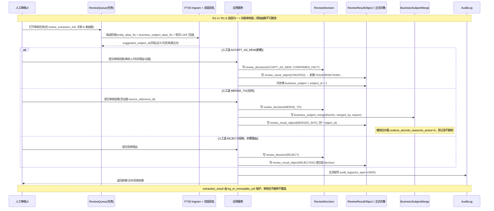

# Phase1.2 架构决策记录（ADR）

> **版本：R2**（Phase 1.2 复审「数据模型完整性与证据追溯」定向整改后）｜日期：2026-11-12
> **R2 承接说明**：本文件已按 R2 复审结论同步修订，唯一真值源为《Phase1.2_数据库表结构设计.md》(**R2**)；统一统计口径 **实体表 75 / FTS5 虚表 24 / 触发器 126 / 视图 0**（R1 的「触发器 96」已作废）。R2 仅针对 7 项阻断（P1~P7）+ 4 项实现边界（B1~B4）定向整改，不全面重做 Phase 1.2。
> **命名声明（P6）**：`check_polymorphic_refs` 是**应用层执行的一组 SQL 自检语句集**，SQLite **没有原生存储过程**、不能 `CALL`；R1 的 `sp_` 前缀命名已全文废弃，全文统一为新名。

> 系统：EPCS Shipbuilding Intelligence　日期：2026-11-12　决策人：系统架构师（高见远）
> 本文档对本阶段开放问题 OQ-1~7 及 12 个架构问题给出**决策记录**（含方案对比与推荐），便于后续评审与变更跟踪。每个 ADR 格式：背景 / 方案 / 优缺点 / 推荐 / 状态。
> R1 整改同步：2026-11-12（**R1 时点历史记录**）；当前唯一真值源为《Phase1.2_数据库表结构设计.md》(**R2**)，统计口径见上方「R2 承接说明」。

---

## ADR-1 项目/船舶/合同建模（架构问题 1）

- **背景**：B.1 产品已定"项目承载一艘主造对象、多合同靠 组织×角色 + 关联文档 表达；不强合同表"。OQ-1 遗留是否引入独立 Contract 强实体。
- **方案A（推荐·弱实体）**：项目承载主造对象（`project.main_object_entity_id→entity`）；合同事实用 `project_member(is_contract_carrier=1)` + `source_reference` 关联文档承载；不建 `contract` 表。未来若需合同强实体，可新增表并入 `project` 而不破坏现有结构。
- **方案B（强合同实体）**：独立 `contract` 表（合同号、甲方/乙方、金额、签署）。
  - 优点：合同维度强表达、可独立查询/审计。
  - 缺点：违背"不强实体"产品倾向、一期增加复杂度、合同与角色关系需再建模。
- **优点（A）**：贴合产品倾向；组织×角色三维本就承载合同；动态可扩展。
- **缺点（A）**：合同级专属字段（金额/份数）暂无处放——一期用 `project.contract_summary` + 文档/evidence 承载。
- **推荐**：**方案A（弱实体）**，`project_member.is_contract_carrier` 备好升级位。多船/船队经 `project↔entity`(M:N) 扩展，不封闭。
- **状态**：定。
- **R1 补充**：`project.main_object_entity_id → entity(id)` 与 `equipment.manufacturer_entity_id → entity(id)` 两处 FK 由原稿"注释后置/动态"改为**显式 `REFERENCES entity(id)`**（R1-6 逐项整改）；建表顺序相应把 `entity` 等基础表**前置**到域1 之前（SQLite 允许 FK 引用后置表，前移仅为可读性与向 PostgreSQL 迁移的依赖拓扑准备）。另新增 `department` 表与 `person.department_id`。

---

## ADR-2 EPCS 阶段与专业/区域/系统的关系（架构问题 2）

- **背景**：B.2 定 EPCS 为时间纵轴、专业/区域/系统为横坐标，正交、可并列，禁止 status 枚举锁死。OQ-5 问实现粒度（统一关联表 vs 分表）。
- **方案A（推荐·统一关联表）**：`object_dimension_tag` 一张表，`dimension ∈ {EPCS_PHASE, DISCIPLINE, AREA, SYSTEM}` + `value_id/value_text`。
  - 优点：统一接口、任意对象打任意多标签、自由值表达"阶段不确定/跨阶段"、FTS 命中统一；新增维度只加 dimension 枚举不动表。
  - 缺点：SQL 上对某一路维度查询需按 dimension 过滤；性能由 `idx_odt_dim(dimension,value_id)` 补偿。
- **方案B（分表）**：`issue_phase`/`issue_discipline`… 每对运行时建表。
  - 优点：查询直观。
  - 缺点：对象×维度无数组合、schema 爆炸、维护难。
- **推荐**：**方案A**。主维度允许放快捷列（如 `plan_activity.discipline_id`）提性能，副维度一律走 tag。
- **状态**：定（OQ-5 关闭为"统一关联表"）。
- **R1 补充**：`object_dimension_tag` 增 `CHECK(value_type IN ('REF','FREE_TEXT'))` 及 REF/FREE_TEXT 值互斥约束（`value_type='REF' → value_id IS NOT NULL AND value_text IS NULL`；`value_type='FREE_TEXT' → value_text IS NOT NULL AND value_id IS NULL`），修复原稿仅有 `dimension` CHECK、值类型可乱填的问题（R1-6 逐项整改，实测拦截非法行）。

---

## ADR-3 人员/组织/项目角色关联（架构问题 3）

- **背景**：Organization→Person 1:N；人员跨项目承担角色须可表达且不重复定义。
- **方案（定）**：`organization→person` 1:N；`project_member` = project×organization×person×role×valid_from，`UNIQUE` 防重复，`is_contract_carrier` 承载合同事实（ADR-1）。同人多项目多角色由多次 `project_member` 表达。用户/账号体系（`user`）Phase 后期启用，与 `person` 关联预留。
- **推荐**：此方案。`person_id` 可空以支持"组织级角色"。
- **状态**：定。
- **R1 补充**：`project_member` 删除表内 `UNIQUE(project_id, organization_id, person_id, role_name, valid_from)` —— SQLite 的 `UNIQUE` 视 NULL 互不相等，`person_id`/`valid_from` 可空时会插入重复组合（**NULL 唯一性漏洞**）；改用**表达式唯一索引** `uq_pm ON project_member(project_id, organization_id, COALESCE(person_id,''), role_name, COALESCE(valid_from,''))`（实测重复被拦截，R1-6 逐项整改）。

---

## ADR-4 "一问题多计划活动/邮件/会议/文件"多对多（架构问题 4，B.3）

- **背景**：Issue↔PlanActivity/Email/Meeting(Minutes)/Document/Drawing/Message/Evidence 全部 M:N，统一经引用桥，实现一页纸问题看板。
- **方案A（推荐·对象桥）**：`object_link(left_type,left_id / right_type,right_id, role, context_excerpt)`，M:N；来源承载走 `source_reference`。
  - 优点：一个桥覆盖全部业务对象间 M:N，schema 不膨胀；新增对象类型不改表。
  - 缺点：多态引用无硬 FK，需应用层+审计+摄入校验兜底。
- **方案B（每对建关联表）**：issue_activity/issue_email/issue_document…。
  - 缺点：组合爆炸、维护成本高，且"一文件被多引用"（B.4）会裂成多张。
- **推荐**：**方案A（`object_link`）**，配合 OQ-2 的合并链（ADR-6，R1 已修订为业务事项双层归一）。
- **状态**：定。
- **R1 补充**：`object_link` 等多态引用新增可执行自检策略 `check_polymorphic_refs`（一组 UNION 查询，按 type 分派到目标表查孤儿，覆盖 `source_reference` / `object_link` / `evidence_link` / `decision_link` / `action_measure_link` / `review_result_object` / `business_subject_alias` / `object_dimension_tag`），**摄入作业完成后 + 定期执行，结果写 `audit_log`**。明确这是"应用层校验 + 自检 + 审计"三层补偿的**已知取舍**：多态字段无硬 FK，不伪装成数据库硬约束（R1-6 逐项整改）。

---

## ADR-5 "一个文件被多事项引用"多对多（架构问题 5，B.4）

- **背景**：文件/图纸只读事实源，被多个（问题/任务/决策/活动/风险/知识）同时引用，且引用带上下文摘录。
- **方案（定）**：`source_reference` 已含 `traced_entity + source + context_excerpt + locator`，即一文件被 N 个`traced_entity`引用（N 行 source_reference，source 同一）；文件端只读（`document.is_readonly=1`）+版本化，不可反向篡改。检索时按 `source_id` 反查可得引用方列表。
- **补充**：引用上下文摘录 `context_excerpt` 满足"引了哪段/哪图"回溯（B.4）。
- **推荐**：直接采用，不另建表。
- **状态**：定。
- **R1 补充**：`source_reference` 的 `traced_entity_type/id` 与 `source_type/id` 均为多态引用，纳入 `check_polymorphic_refs` 自检（UNION 查询按 type 分派查孤儿，摄入后 + 定期执行，结果写 `audit_log`）；与 `object_link`、各 `*_link`（`evidence_link` / `decision_link` / `action_measure_link`）同属**"应用层 + 自检 + 审计"三层补偿的已知取舍**，多态字段无硬 FK、不伪装成数据库硬约束（R1-6 逐项整改，与 ADR-4 同一策略）。

---

## ADR-6 全局实体标识 + 合并机制防重复（架构问题 6，B.5 / OQ-2）

> **原结论作废**：原稿把「同一问题」的合并交给 `entity_relationship(synonym/merge)`，并写「`issue` 本身不直接自引用合并，一律经 `entity` 归一」——**混淆了业务实体**（设备/船舶/区域/组织/供应商等名词）**与业务事项**（Issue/Risk/Task/Decision/KnowledgeItem 等事件），导致 Issue 无别名、无来源证据链、无法撤销错误合并、合并后原记录语义丢失。R1 按双层归一重写本 ADR。

- **背景**：同一业务事项（如某问题）可能在邮件/会议/任务中重复出现；同时设备/船舶/组织等业务实体也需跨来源归一。二者语义不同，须**分层**处理，且合并链可逆、历史不丢。
- **方案（R1 定案·双层归一）**：
  1. **业务实体层**：`entity` + `entity_alias` + `entity_identifier` + `entity_relationship`，**只管**设备/船舶/区域/组织/供应商/专业等实体的语义关系与别名；**`entity_relationship` 不得承载业务事项合并**。
  2. **业务事项层**：`business_subject`（统一事项主档，`subject_kind` ∈ ISSUE/RISK/TASK/DECISION/KNOWLEDGE_ITEM）+ `business_subject_alias`（一事项多别名）+ `business_subject_merge`（**可逆合并链**）+ `business_subject_source`（事项↔来源证据 M:N，保留每次出现位置）。
  3. **1:1 挂载**：`issue/risk/task/decision/knowledge_item` 各增 `subject_id TEXT NOT NULL UNIQUE REFERENCES business_subject(id)`（1:1）。
  4. **可逆撤销**：撤销合并通过 `business_subject_merge.undone_at/undone_by/undo_reason/is_active=0` 实现，`from_subject.status` 由 MERGED 回 ACTIVE、`canonical_subject_id` 清空；**原业务记录不删除、不覆盖**，仅标 `status=MERGED` 并保留 canonical 指针，历史引用经 canonical 链全部可回放。
  5. **审核链**：`extraction_result`(AI_INFERENCE) → `review_extraction_link` → `review_queue`（`business_subject_alias_fts` 候选检索 + `source_reference` 比对）→ `review_decision`（人工，含审核人/时间/理由/证据）→ `review_result_object` → 正式对象或 `business_subject_merge`（详见 ADR-7 / R1-5）。
- **优点**：实体与事项语义分离；合并可逆、原始记录不丢；别名/来源/审核证据链完整；防重复（未经人工确认不落正式对象）。
- **缺点**：表数量增加（新增 `business_subject` 等 4 张 + 审核链 4 张）；多态引用需 `check_polymorphic_refs` 自检（见 ADR-4/5 的已知取舍）。
- **推荐**：采用 R1 双层归一定案。
- **状态**：定（R1 修订）。**OQ-2 重新关闭**为该结论：业务实体 / 业务事项双层归一 + 可逆合并链 `business_subject_merge`；原「一律经 entity 归一、issue 不直接自引用合并」作废。

---

## ADR-7 AI 推断与人工事实分离（架构问题 7，B.8 / OQ-7）

> **原 FTS 结论作废**：原稿推荐「外部内容表 + 触发器同步」，且《核心实体数据字典》原 §7.2 写过 `content_rowid='id'`（TEXT UUID）。SQLite FTS5 外部内容表的 `content_rowid` **必须是整数 rowid**，TEXT UUID 无法映射（实测所有行被压成 rowid 0）；外部内容表 `count(*)` 读 content 表不反映索引，幽灵行只有 `integrity-check` 能发现；且要求列名与主表严格对应，旧草案 `document_fts(name,snapshot_json)` 等列根本不存在于被索引表。R1 改为统一普通内容表范式。

- **背景**：信息性质六层 G5 定案；AI 产出默认 `AI_INFERENCE` 进 ReviewQueue；FTS 中文检索须 trigram + 双层别名召回；审核链须完整可回放。
- **方案（R1 定案）**：
  1. `info_nature` 六枚举**全库强制**作基字段（`CHECK` + `system_config` 双轨，OQ-4）；`AI_INFERENCE/PREDICTION/PROPOSAL` 不得自动升级为正式事实，须经人工确认。
  2. **FTS 统一范式**：全库 24 张 `tokenize='trigram'` 虚表一律采用**普通内容表（contentful）+ `biz_id UNINDEXED` 显式业务 UUID 映射**（版本表另带 `owner_biz_id` 指向主对象）；**不再使用外部内容表**。业务表与 FTS 表一一对应（见《表结构设计》§7.2），**索引全部历史版本**，主表另建元数据 FTS；查询返回稳定 `biz_id` 再回业务表。
  3. **同步**：每张内容表 3 个触发器（`AFTER INSERT` / `AFTER UPDATE WHEN 文本字段变化` / `AFTER DELETE`），24×3 = **72** 个；UPDATE 采用「先 DELETE 旧 FTS 行再 INSERT 新行」避免 trigram 值漂移。
  4. **软删 / 重建 / 一致性**：软删**保留 FTS 行**，仅把 `is_deleted` 镜像置 1，查询统一带 `AND is_deleted=0` 并 JOIN 主表二次过滤；归档不改 FTS；支持全量重建（`DELETE FROM x_fts; INSERT INTO x_fts(...) SELECT ...`）与 4 项一致性自检（活跃行数差 / `biz_id` 孤儿 / 软删镜像一致 / trigram 正向自检）。
  5. **中文检索**：trigram 三字以上中文词正常命中；**1~2 字短词 MATCH 恒为 0**，须降级 **LIKE 回退**（限定项目/候选集 + `LIMIT`），并联合 `entity_alias_fts` / `business_subject_alias_fts` 双层别名表做短词等值召回；含 `-` `/` 等 FTS5 语法字符的查询词必须**整体双引号包裹**（`'"' + term.replace('"','""') + '"'`），否则报 `no such column` / `syntax error`。
  6. **审核链（R1-5）**：`extraction_result`(AI_INFERENCE) → `review_extraction_link`(M:N) → `review_queue`(纯审核任务) → `review_decision`(ACCEPT_AS_NEW / MERGE_TO / REJECT，含审核人/时间/理由/证据) → `review_result_object`(→正式对象稳定映射)；原始抽取由 `trg_er_immutable_u/d` 保护，审核后不得删除或覆盖。G5 链：`AI_INFERENCE → CONFIRMED_FACT → 正式对象 CONFIRMED_FACT`。
- **推荐**：`info_nature` 用 **`CHECK` + `system_config` 双轨**；FTS 用**统一普通内容表 + `biz_id` 显式映射 + 三向触发器 + 软删镜像 + LIKE 短词回退 + 双引号转义**。
- **状态**：定（R1 修订）。**OQ-7 重新关闭**为该结论；OQ-4 仍为双轨。

### ADR-7b FTS 同步策略（R1 修订）

| 方案 | 说明 | 结论 |
|---|---|---|
| 三向触发器即时同步（采用） | 24 张内容表 × INSERT/UPDATE/DELETE = **72** 个触发器，UPDATE 先删后插，查询最新 | ✅ **一期定案**：写入频率低、成本可忽略 |
| 摄入后批量重建 | `DELETE FROM x_fts` + `INSERT ... SELECT FROM 业务表` 全量重灌 | 作为**一致性修复与灾后重建**手段保留，接口 `rebuild_fts()`，不作日常同步 |
| 定时任务重建 | 依赖外部调度 | ❌ 一期不引 |

推荐：**三向触发器即时同步 + 摄入后 4 项一致性自检 + 可全量重建**；每次摄入后与定期维护运行 `check_polymorphic_refs` 与 FTS 一致性检查，结果写 `audit_log`。原「外部内容表 + 触发器同步」结论作废。

---

## ADR-8 计划版本/批准基线/滚动预测共存（架构问题 8，B.7 / OQ-3）

> **原结论作废**：原稿把当前生效状态放在 `baseline_version.is_active` 上、用「`is_active` 部分唯一索引」保证一时一基线。四条致命缺陷：① `UNIQUE(plan_id,is_active)` 使一个计划**最多 2 条基线**（is_active 仅 0/1），违反「多个历史批准基线」；② 状态与内容同表，切换基线必须 `UPDATE baseline_version`，触发器一旦放行该 UPDATE 就无法阻止顺带改 `plan_version_id`/`approved_at` 等内容字段；③ 原触发器条件 `(NEW.is_active <> OLD.is_active) IS 0` 语义诡异且**放行所有含 is_active 变更的更新**；④ 切换无授权人、无审计。R1 改为状态分离。

- **背景**：Plan→PlanVersion 1:N；Plan→BaselineVersion 1:N（多个历史批准基线）；某一刻仅一个当前生效基线；滚动预测以多版本发布而非造表；批准基线内容真正只读、历史可回放。
- **方案（R1 定案）**：
  1. **删除** `UNIQUE(plan_id, is_active)` 与 `baseline_version.is_active` 字段；`baseline_version` 保留 `UNIQUE(plan_id,baseline_no)`，新增 `UNIQUE(plan_id,plan_version_id)`、`approved_at/approved_by/content_hash`、`is_readonly=1 CHECK(is_readonly=1)`。
  2. **状态分离**：新增 `plan_active_baseline(plan_id PK, baseline_version_id FK, is_active=1, switched_at, switched_by, authorization_ref, reason)` 作当前生效指针；部分唯一索引 `uq_pab_active ON plan_active_baseline(plan_id) WHERE is_active=1` 保证「同一计划最多一个当前生效基线」；新增 `baseline_switch_log` 记录每次切换的 from/to、授权人、时间、理由、audit_log_id。
  3. **无差别冻结**：`trg_bl_freeze_u BEFORE UPDATE ON baseline_version WHEN OLD.is_readonly=1 → RAISE(ABORT,'baseline frozen: content immutable')` 与 `trg_bl_freeze_d BEFORE DELETE ... → RAISE(ABORT,'baseline frozen: physical delete disabled')`，**不看任何字段**，杜绝通过改 is_active 绕过内容只读。
  4. **切换流程**（应用层单事务）：校验目标基线属于该 plan 且已批准 → 写 `baseline_switch_log` + `audit_log` → UPSERT `plan_active_baseline`；**全程不触碰 `baseline_version` 任何行**。
  5. **计划活动版本化（R1-2）**：`plan_activity` 降为稳定主实体；新增 `plan_activity_version`（每版本属性快照，`change_type` ∈ ADDED/MODIFIED/UNCHANGED/REMOVED，`UNIQUE(activity_id, plan_version_id)`）；`activity_dependency` 增 `plan_version_id`；`baseline_version.plan_version_id` 明确指向**完整计划版本**，故可按 `baseline → plan_version → plan_activity_version` 回放批准计划、做 V1/V2 差异对比、以及当前滚动预测 vs 批准基线对比。
  6. **AI 边界**：AI/自动化仅允许 INSERT `plan_version(is_forecast=1)`（`info_nature=PREDICTION`，**不能成为批准基线**）；`baseline_version` 的 INSERT 与切换要求 `actor_type='USER'` 且 `authorization_ref` 非空，并写 `audit_log`。
  7. **防御层次**：数据库层无差别冻结触发器 + 应用层写入白名单 + `plan_active_baseline` 状态分离 + `audit_log`/`baseline_switch_log` 审计，共**四层**（原 OQ-3「三重防御」细化）。
- **推荐**：采用 R1 状态分离方案。
- **状态**：定（R1 修订，OQ-3 重新关闭）。**六个基线测试案例全 PASS**（两条历史基线共存 / 第二条生效 / 第一条内容不可改 / 物理删除被阻止 / 同计划不能有两个生效基线 / 不同计划各有一个生效基线）；V1/V2 差异与历史回放实测 PASS。见《表结构设计》§2.4 / §2.5 / §8-C / §8-D。

---

## ADR-9 业务数据完整历史（架构问题 9，G4）

- **背景**：版本化+软删+历史回放；正式记录禁物理删除；成本可控。
- **方案A（推荐）**：版本容器（`*_version` + 内容 hash + snapshot_json 渐进）＋状态历史表＋软删（is_deleted/del_status）＋正式表禁物理删除触发器。快照先记录 `assets/` 资产引用，全量快照按需补。
  - 优点：历史完整可回放；一期成本可控。
  - 缺点：snapshot_json 全量 vs 增量需定（D.2 待人工确认成本边界）。
- **方案B（全量快照每版）**：历史最全但存储成本高、一期过度。**不采用**。
- **推荐**：**方案A**。
- **状态**：定（快照粒度 D.2-6 待确认）。
- **R1 补充**：版本容器新增 `plan_activity_version`（每计划版本的活动属性快照，`change_type` 四值），并新增 `baseline_switch_log` 承载基线切换全历史（R1-1/R1-2）；`document_version` / `drawing_version` / `meeting_minutes` / `knowledge_version` / `plan_activity_version` **全部历史版本**入 FTS（不只当前版本）。明确区分「文件 / 计划版本」与「业务事项版本」：后者由 `business_subject` + 状态历史 + 可逆 `business_subject_merge` 承载（见 ADR-6），二者不混用同一套版本容器。

---

## ADR-10 DWG 图纸对象预留（架构问题 10）

- **背景**：未来 DWG 解析涉及图纸↔设备/区域/系统/问题关联；本阶段**不装 SDK、不解析**，仅预留结构。
- **方案（定）**：`drawing(+drawing_version)` 已承载图纸与 revision；`drawing_object` 预留 DWG 对象表：`obj_type / ref_entity_id / ref_area_id / ref_system_id / geometry_json(占位) / reserved_data`。未来装 SDK 后只填字段，不改 schema。
- **关联预留**：`drawing` 已可经 `source_reference`/`object_link` 与 issue/equipment 等关联；`drawing_object.ref_entity_id→entity` 即设备/部位归一。
- **推荐**：直接采用；不引入 SDK、不引外部坐标格式假定。
- **状态**：定（DWG SDK 选型属后续 Phase，另行审批）。

---

## ADR-11 事项跨 E/P/C/S 阶段跟踪（架构问题 11，B.2）

- **背景**：一个对象（问题/风险/决策…）在建造推进中横跨多个 EPCS 阶段，且阶段可与专业/区域/系统并列，允许"阶段不确定/跨阶段"。
- **方案（定）**：对象挂 `object_dimension_tag(dimension=EPCS_PHASE, value_id 或 value_text="不确定/跨阶段")` **追加式**表达——对象生命周期跨阶段以标签累积呈现，而非把阶段做成会覆盖的 status。查询"当前处于哪些阶段"= 过滤该对象的最新 tag 集；历史跨阶段由 tag 时间戳回放。
- **补充**：`project_phase` 记录项目级 EPCS 实例，全局阶段目录由 `system_config`/dimension 归口，不硬编码。
- **推荐**：直接采用（与 ADR-2 同机制）。
- **状态**：定。

---

## ADR-12 避免旧库硬编码与固定目录（架构问题 12，G1/G3/G7）

- **背景**：旧库存在硬编码船名/项目/专业、固定目录问题；本系统全新建模，G3 严格隔离。
- **方案（定）**：
  - 一切维度值（船型/项目/专业/区域/系统/角色/枚举）入**维度表或 `system_config`**，ID 引用，杜绝字面值（G7）。
  - 外部自然编号统一入 `entity_identifier`（id_type/source_from/identifier）+ `EntityAlias`（简称/译名），不写死。
  - 原始资料 `02_Original_References` 只读归档，不复制旧结构、不引旧脚本/旧库（G3 表）。
  - 全库 Schema 由唯一 `migrations` 管理，永不经手工改库。
- **推荐**：此方案即"全链维度化 + 只读来源 + 唯一 schema 源"。
- **状态**：定。
- **R1 补充**：`entity_identifier` 唯一范围由全局 `UNIQUE(id_type, identifier)` **收敛**为 `UNIQUE(entity_id, id_type, COALESCE(source_from,''), identifier)`（同一实体/类型/来源下唯一，另建 `(id_type, identifier)` 非唯一检索索引），避免不同来源系统同号即冲突；`drawing_no` 唯一范围由全局 `UNIQUE(drawing_no)` **收敛**为按 `COALESCE(project_id,'')` 的表达式唯一索引（不同项目可同图号）；新增 `department` 维度表（与 `organization.parent_id` 上下级单位职责分离）；全库统一 `uuid4().hex` + `CHECK(length(id)=32 AND id NOT GLOB '*[^0-9a-f]*')`（R1-6 逐项整改）。

---

## 类图与程序调用流（架构层，R1 重绘）

### 类图（数据模型核心类）

```mermaid
classDiagram
    class Project { +id: UUID +project_code: str +main_object_entity_id: UUID +status: str }
    class ProjectPhase { +phase_code: str +seq_no: int }
    class Organization { +org_code: str +name: str }
    class Department { +code: str +name: str +parent_id: UUID }
    class Person { +name: str }
    class ProjectMember { +role_name: str +is_contract_carrier: bool }
    class Equipment { +name: str +manufacturer_entity_id: UUID }
    class Plan { +name: str +level: str }
    class PlanVersion { +version_no: str +is_forecast: bool }
    class BaselineVersion { +baseline_no: str +is_readonly: bool +content_hash: str }
    class PlanActiveBaseline { +plan_id: UUID +baseline_version_id: UUID +authorization_ref: str }
    class BaselineSwitchLog { +from_baseline_id: UUID +to_baseline_id: UUID +switched_by: UUID }
    class PlanActivity { +code: str +first_version_id: UUID }
    class PlanActivityVersion { +change_type: str +planned_start: str +planned_end: str }
    class ProgressRecord { +progress_pct: float }
    class BusinessSubject { +subject_kind: str +status: str +canonical_subject_id: UUID }
    class BusinessSubjectAlias { +alias: str +confirm_status: str }
    class BusinessSubjectMerge { +from_subject_id: UUID +to_subject_id: UUID +undone_at: str }
    class BusinessSubjectSource { +source_reference_id: UUID }
    class Issue { +ref_no: str +status: str +subject_id: UUID }
    class IssueStatusHistory { +new_status: str +reopen_count: int }
    class Risk { +ref_no: str +strategy: str +subject_id: UUID }
    class Task { +ref_no: str +subject_id: UUID }
    class Decision { +conclusion: str +subject_id: UUID }
    class KnowledgeItem { +title: str +subject_id: UUID }
    class ActionMeasure { +measure_type: str }
    class SourceReference { +traced_entity_type: str +source_type: str +context_excerpt: str }
    class Evidence { +title: str +sha256: str }
    class ObjectLink { +link_role: str +right_type: str }
    class ObjectDimensionTag { +dimension: str +value_type: str }
    class Entity { +name: str +entity_kind: str +status: str }
    class EntityAlias { +alias: str }
    class EntityIdentifier { +id_type: str +identifier: str }
    class EntityRelationship { +relation_type: str }
    class KnowledgeVersion { +content_md: str }
    class IngestionJob { +source_type: str +status: str }
    class ExtractionResult { +candidate_type: str +confidence: float }
    class ReviewQueue { +review_type: str +status: str +candidate_summary: str }
    class ReviewExtractionLink { +review_queue_id: UUID +extraction_result_id: UUID }
    class ReviewDecision { +decision: str +reviewer_person_id: UUID +reason: str }
    class ReviewResultObject { +object_type: str +object_id: UUID +relation: str }
    class AuditLog { +actor_type: str +action_code: str }

    Project "1" --> "0..*" ProjectPhase
    Project "1" --> "0..*" ProjectMember
    Organization "1" --> "0..*" Department
    Organization "1" --> "0..*" Person
    Department "1" --> "0..*" Person
    Department "1" --> "0..*" Department : parent
    Organization "1" --> "0..*" ProjectMember
    Project "1" --> "0..*" Plan
    Plan "1" --> "0..*" PlanVersion
    Plan "1" --> "0..*" BaselineVersion
    Plan "1" --> "0..*" PlanActiveBaseline
    Plan "1" --> "0..*" BaselineSwitchLog
    BaselineVersion "1" --> "0..1" PlanActiveBaseline : points
    PlanVersion "1" --> "0..*" PlanActivityVersion
    PlanActivity "1" --> "0..*" PlanActivityVersion
    PlanActivity "1" --> "0..*" ProgressRecord
    BusinessSubject "1" --> "0..*" BusinessSubjectAlias
    BusinessSubject "1" --> "0..*" BusinessSubjectMerge : from_or_to
    BusinessSubject "1" --> "0..*" BusinessSubjectSource
    BusinessSubject "0..1" --> "0..1" BusinessSubject : canonical
    BusinessSubject "1" --> "0..1" Issue : "1:1 subject_id"
    BusinessSubject "1" --> "0..1" Risk : "1:1 subject_id"
    BusinessSubject "1" --> "0..1" Task : "1:1 subject_id"
    BusinessSubject "1" --> "0..1" Decision : "1:1 subject_id"
    BusinessSubject "1" --> "0..1" KnowledgeItem : "1:1 subject_id"
    Project "1" --> "0..*" Issue
    Issue "1" --> "0..*" IssueStatusHistory
    Project "1" --> "0..*" Risk
    Project "1" --> "0..*" Task
    Entity "1" ..> "0..*" EntityAlias : has
    Entity "1" ..> "0..*" EntityIdentifier : has
    Entity "1" --> "0..*" EntityRelationship : "entity-only"
    Entity "0..1" --> "0..1" Entity : canonical_merge_entities_only
    KnowledgeItem "1" --> "0..*" KnowledgeVersion
    IngestionJob "1" --> "0..*" ExtractionResult
    ReviewQueue "1" --> "0..*" ReviewExtractionLink
    ExtractionResult "1" --> "0..*" ReviewExtractionLink
    ReviewQueue "1" --> "0..*" ReviewDecision
    ReviewDecision "1" --> "0..*" ReviewResultObject
    SourceReference ..> Entity : traces(M:N)
    ObjectLink ..> Entity : relates(M:N)
    ObjectDimensionTag ..> Entity : tags(M:N)
```

> 注：`ReviewQueue` 为**纯审核任务表**，已去掉 `decision` / `target_entity_id`；`ExtractionResult` 与 `ReviewQueue` 之间不再直连，改经 `ReviewExtractionLink` 的 M:N。`Entity` 自关联只表达**业务实体**归一，业务事项合并一律走 `BusinessSubjectMerge`。

### 程序调用流（摄入 → 审核 → 正式对象，R1 四表链）



---

## 未采纳备选与后续开关

- 独立 `contract` 表：一期不用，ADR-1 备升级位。
- 每对 M:N 独立关联表：不采用，统一 `object_link`（ADR-4）。
- G5 枚举纯 check 或纯 config：采用**双轨**（ADR-7）。
- DWG SDK：本阶段不装（ADR-10），后续 Phase 另行审批。

---

## R1 整改对 ADR 的影响汇总（2026-11-12）

| ADR | 修订性质 | 要点 | 对应整改 |
|---|---|---|---|
| ADR-1 | 补充 | `project.main_object_entity_id` / `equipment.manufacturer_entity_id` 显式 FK；新增 `department`；`entity` 前置建表 | R1-6 |
| ADR-2 | 补充 | `object_dimension_tag.value_type` CHECK(REF/FREE_TEXT) + 值互斥 | R1-6 |
| ADR-3 | 补充 | `project_member` 改 `COALESCE` 表达式唯一索引，修复 NULL 唯一性漏洞 | R1-6 |
| ADR-4 | 补充 | `object_link` 纳入 `check_polymorphic_refs` 多态孤儿自检（应用层 + 自检 + 审计三层补偿，已知取舍） | R1-6 |
| ADR-5 | 补充 | `source_reference` 多态引用纳入同一自检策略 | R1-6 |
| **ADR-6** | **整段重写（原结论作废）** | 业务实体 / 业务事项双层归一；`business_subject` 四表；可逆合并；`entity_relationship` 不得承载事项合并；OQ-2 重新关闭 | **R1-4** |
| **ADR-7 / ADR-7b** | **整段重写（原 FTS 结论作废）** | 统一普通内容表 + `biz_id UNINDEXED`；24 张 FTS 一一对应；三向触发器 72；软删镜像；短词 LIKE 回退；双引号转义；审核四表链；OQ-7 重新关闭 | **R1-3 / R1-5** |
| **ADR-8** | **整段重写（原结论作废）** | 删除 `UNIQUE(plan_id,is_active)`；状态分离 `plan_active_baseline` + `baseline_switch_log`；无差别冻结；`plan_activity_version` 逐版本快照；四层防御；OQ-3 重新关闭 | **R1-1 / R1-2** |
| ADR-9 | 补充 | `plan_activity_version` 与 `baseline_switch_log` 两类历史；全部历史版本入 FTS；区分「文件 / 计划版本」与「业务事项版本」 | R1-2 / R1-3 |
| ADR-10 / ADR-11 | 不变 | DWG 不装 SDK、阶段标签追加式，R1 未涉及 | — |
| ADR-12 | 补充 | `entity_identifier` / `drawing_no` 唯一范围收敛；新增 `department`；UUID CHECK | R1-6 |

> 8 份文档统一统计口径：实体表 **75**（业务主表 46 + 辅助 29）、FTS5 虚表 **24**、触发器 **126**、视图 **0**，见《Phase1.2_数据库表结构设计.md》§0.2。本轮修订的完整「原设计 → 评审问题 → 方案对比 → 修改后设计 → ADR 影响」见《Phase1.2_架构评审整改记录.md》。

## R1 整改同步说明（R1 时点记录；统计口径已按 R2 同步为 126）

1. 保留 ADR-1~5、ADR-9~12 的原始背景、方案对比与优缺点，仅追加「R1 补充」条目。
2. ADR-6 / ADR-7 / ADR-7b / ADR-8 因原结论存在**建表阻断问题**，整段重写并在开头标注「原结论作废」。
3. 类图与时序图按 R1 的 75 张表与四表审核链重绘：删除 `ExtractionResult → ReviewQueue` 直连，改为经 `ReviewExtractionLink` 的 M:N；`BaselineVersion` 去掉 `is_active`；新增 `PlanActiveBaseline` / `BaselineSwitchLog` / `PlanActivityVersion` / `Department` / `BusinessSubject*` / `Review*` 等类。
4. 新增「R1 整改对 ADR 的影响汇总」表，与《架构评审整改记录》§0 总览一致。

---

## R2 新增 ADR（编号接续 ADR-12；2026-11-12 定向整改）

> **背景**：系统架构师对 R1（18 份文档）复审结论为「**暂不通过，继续定向整改**」，认可六项原始阻断问题已有实质整改，但发现 7 项「文档声称已解决、SQL 实际未闭环」问题（P1~P7）+ 4 项实现边界（B1~B4）。R2 只针对这 11 项做定向整改，**不全面重做 Phase 1.2**；R1 的 ADR-1~12 正文与六项整改结论继续有效，被 R2 修订处均已标注。
> **复审便利**：以下 7 条中，**ADR-14（P2）/ ADR-15（P3）/ ADR-17（P5）/ ADR-18（P7）为四条独立决策条目**，逐条按「决策 / 备选方案 / 理由 / 影响文档」书写，另附正向 / 反向测试与状态，便于逐条核对。
> **验证依据**：全部新增/修改 DDL 与 SQL 在操作系统临时目录以 Python `sqlite3.connect(':memory:')`（SQLite 3.53.1）编译并执行正/反向行为测试，**129 项 PASS / 0 FAIL**；按文档原文提取的 133 条 `CREATE` 全部编译通过、执行失败 0、`PRAGMA foreign_key_check` 无违规、`integrity_check = ok`（真值源 §8-I / §8-J）。本阶段**未创建 `001_init.sql`、未对正式库执行 DDL/DML、未导入资料、未执行 git commit**。
> **统一统计口径（R2）**：实体表 **75** / FTS5 虚表 **24** / 触发器 **126** / 视图 **0**。触发器由 R1 的 96 增至 126（+30：ID/归属不可变 24 + 审核证据 2 + 合并链 4），其余对象数量不变。

### ADR-13 P1 计划域跨计划一致性（阻断 P1）

- **背景 / 问题**：`plan_activity_version`、`activity_dependency`、`baseline_version`、`plan_active_baseline`（以及 `plan_activity.first_version_id`、`progress_record`、`baseline_switch_log`）分别引用 `plan_activity(id)` / `plan_version(id)` / `baseline_version(id)` 等**独立单列 FK**，未保证同 `plan_id`。QA 阶段 A 实测 **4/4 跨计划非法写入被 R1 直接接受**，可写出「计划 A 的批准基线指向计划 B 的版本」。
- **决策**：采用**复合唯一键 + 共享 `plan_id` 的复合外键**（数据库级机制，非应用层约定）：
  1. 父表补 `UNIQUE(plan_id, id)`：`plan_version` / `plan_activity` / `baseline_version`（复合 FK 要求被引用列存在匹配 UNIQUE/PRIMARY KEY，否则 SQLite 编译失败）；
  2. 子表新增或改用共享 `plan_id` 的复合 FK：`plan_activity_version(plan_id, activity_id)`、`(plan_id, plan_version_id)`；`activity_dependency` 三个复合 FK；`baseline_version(plan_id, plan_version_id)`；`plan_active_baseline(plan_id, baseline_version_id)`；`progress_record`、`baseline_switch_log`、`plan_activity.first_version_id` 同理；
  3. `plan_activity_version` / `progress_record` 各新增非空列 `plan_id`（实体表仅此 2 列变更，不增表）。
- **备选方案**：① 只靠应用层校验（否决：无法阻止绕过应用直写 DB）；② 用触发器逐表比对 `plan_id`（否决：7 张表 × 增改两类共 14 个触发器，且触发器内子查询易被 `PRAGMA foreign_keys=OFF` 绕过，维护成本高于复合 FK）；③ 建 `plan_object` 中间表统一 ID（否决：改变 75 张表结构，超出定向整改范围）。
- **理由**：复合 FK 是 SQLite 原生、可被 `PRAGMA foreign_key_check` 验证的声明式约束；配合父表匹配 UNIQUE 索引可真实编译执行，且不需要新增实体表或视图。
- **影响文档**：真值源 §2 / §0.2 / §8-J J1 / §12.1；数据字典 §2；ER 图计划域关系行；版本及历史管理规范 §2；统一数据模型总体设计 §4；R2 整改记录 P1 / 完成报告。
- **正 / 反向测试**：正向——6 类同计划对象（活动版本、依赖、基线、生效基线、进度、切换日志）全部插入成功；反向——「A 计划活动挂 B 计划版本」「A 计划基线指向 B 计划版本」「A 状态表指向 B 基线」「依赖/进度/切换日志跨计划」共 7 项全部被 `FOREIGN KEY constraint failed` 拒绝。
- **状态**：R2 定案，等待系统架构师再次审核。

### ADR-14 P2 `action_measure` 属主语义（阻断 P2）【独立条目】

- **背景 / 问题**：R1 SQL 是 XOR `CHECK((risk_id IS NOT NULL AND issue_id IS NULL) OR (issue_id IS NOT NULL AND risk_id IS NULL))`（**恰好一个非空**），但 R1 整改报告写「至少一个非空」、新增 `action_measure_link` 又宣称「一个措施挂多个属主 M:N」，三处矛盾。QA 阶段 A 另实证两点：`measure_type='RISK_RESPONSE'` 却挂 `issue_id` 被接受（无语义 CHECK）；`action_measure_link.ref_id` 写不存在的对象（孤儿）被接受。
- **决策**：
  1. **保留 XOR CHECK 作为「唯一主属主」语义**：恰好一个主属主非空，禁止双非空、禁止零属主；
  2. `action_measure_link` 只承载 **0..N 附加属主**，**不得重复登记主属主**（由真值源 §7.6.3 的职责边界自检检出）；
  3. **新增 `measure_type` 语义 CHECK**：`measure_type='RISK_RESPONSE' ⇒ risk_id IS NOT NULL AND issue_id IS NULL`；`measure_type='ISSUE_REMEDY' ⇒ issue_id IS NOT NULL AND risk_id IS NULL`。该 CHECK 蕴含并强化 XOR，杜绝 QA 实测的两类错挂；
  4. `action_measure_link.ref_id` 明确为**多态引用、无硬 FK**（与 `object_link` / `source_reference` 一致）；孤儿由 P6 的 `q7` 分支（`target` 23 类全集 + `IS NULL` 反连接）**必然检出**，配合应用层校验与 `audit_log` 留痕三层补偿，**不伪装成数据库硬约束**；
  5. 全文（真值源 / 数据字典 / ER 图 / 追溯规范 / 总体设计 / R1 两份报告标注 / R2 两份新文档）统一措辞为「**恰好一个主属主 + 0..N 附加属主**」。
- **备选方案**：① 把 CHECK 改为 `>=1` 允许双非空（**否决**：与 `action_measure_link` 职责重叠、无法区分主/附加属主，且 `measure_type` 语义 CHECK 无处安放，报告与 SQL 仍会各行其是）；② 给 `ref_id` 加硬 FK（**否决**：多态引用无法用单列 FK 表达，需按 type 建 23 张子表或触发器分派，复杂度与收益不匹配；沿用 ADR-4 / ADR-5 既有取舍）；③ 删除 `action_measure_link` 只留 XOR（**否决**：丢失「一措施关联多事项」的真实业务需求）。
- **理由**：XOR 是 R1 真值源 SQL 的既成事实，把它正名为「唯一主属主」可一次性消除报告 / 字典 / ER / SQL 的措辞冲突；语义 CHECK 与 `q7` 全类型自检分别补上 QA 实测的两个缺口，且都不改变 75 张表 / 24 张 FTS / 126 触发器的统计口径。
- **影响文档**：真值源 §4（DDL + 职责边界注释）/ §7.6.2 映射表 `q7` / §7.6.3 P2 自检 / §8-J J2 / §12.1 P2 / §12.3；数据字典 §4.5 `action_measure` / `action_measure_link`；ER 图关系注第 5 条；统一数据模型总体设计 §4；R1 整改记录 §5 第 5 项标注「本结论已被 R2 修订」；R2 整改记录 P2 / 完成报告。
- **正 / 反向测试**：正向——`RISK_RESPONSE` + `risk_id`、`ISSUE_REMEDY` + `issue_id` 各 1 条通过，2 条合法附加属主 link 通过；反向——双主属主 / 零主属主 / `RISK_RESPONSE` 挂 `issue_id` / `ISSUE_REMEDY` 挂 `risk_id` 均被 `CHECK` 拒绝；`link.ref_id` 孤儿被 `q7` 检出；link 重复登记主属主被职责边界自检检出。
- **状态**：R2 定案，等待系统架构师再次审核。

### ADR-15 P3 `review_decision` 证据必填（阻断 P3）【独立条目】

- **背景 / 问题**：`review_decision.evidence_source_reference_id TEXT REFERENCES source_reference(id)` 在 R1 **无 `NOT NULL`**，但《数据来源与证据追溯规范》与 R1 整改报告、真值源 §6.5 验证表均声称「审核人 / 时间 / 理由 / 证据 PASS（约束强制）」——属文档与 SQL 不一致的不实结论。QA 实测「审核证据为空」被 R1 直接接受。
- **决策**：**不引入例外审核类型枚举**——所有审核决定（含 `REJECT`）一律绑定来源证据：
  1. `evidence_source_reference_id TEXT NOT NULL REFERENCES source_reference(id)`；
  2. 新增 2 个触发器 `trg_rd_evidence_i` / `trg_rd_evidence_u`：写入或换绑时校验对应 `source_reference` 存在且 `is_deleted = 0`（FK 只保证存在、不检查软删）；
  3. 事后软删（决定写入后证据被软删）由真值源 §7.6.3 的 P3 一致性自检检出，结果写 `audit_log`；
  4. 修正真值源 §6.5 验证表与 §8-E E4 的「PASS（约束强制）」不实结论，明确标注「R1 结论不实 → R2 闭环」。
- **备选方案**：① 允许例外（定义 `decision IN (...)` 或 `evidence_exempt_reason` 例外枚举 + CHECK）（**否决**：会打开「无证据审核」口子，与 G2 来源可追溯底线冲突，且需要额外审核治理规则，超出定向整改范围）；② 只加 `NOT NULL` 不加触发器（**否决**：无法阻止绑定已软删的僵尸证据，QA 实测的「证据存在但已软删」仍可写入）；③ 仅靠应用层 / 自检（**否决**：复审明确要求数据库级约束闭环）。
- **理由**：审核决定是把 `AI_INFERENCE` 升级为 `CONFIRMED_FACT` 的唯一人工关口（ADR-7），证据必填是 G2 追溯链不可妥协的一环；`NOT NULL` + FK + 触发器 + 事后自检构成写入时与事后两道防线。
- **影响文档**：真值源 §6（DDL + 2 触发器）/ §6.5 验证表 / §7.6.3 P3 自检 / §8-E E4 / §8-J J3 / §12.1 P3；数据字典 §6 `review_decision`；追溯规范 §2 审核链；R1 整改完成报告「PASS（约束强制）」类结论标注；R2 整改记录 P3 / 完成报告。
- **正 / 反向测试**：正向——绑定有效未软删证据的 `ACCEPT_AS_NEW` 决定写入成功；反向——空证据被 `NOT NULL` 拒绝、不存在的证据被 FK 拒绝、已软删证据被触发器 `RAISE(ABORT)` 拒绝、`UPDATE` 换绑已软删证据被拒绝、证据事后软删被一致性自检检出。
- **状态**：R2 定案，等待系统架构师再次审核。

### ADR-16 P4 双层追溯结构 + P6 多态自检语句集（阻断 P4 / P6）

- **背景 / 问题**：P4——R1 已正确把 `entity`（船舶/设备/区域/组织）与 `business_subject`（ISSUE/RISK/TASK/DECISION/KNOWLEDGE_ITEM）分层，但追溯规范 §1 仍写「`plan_activity` / `knowledge_item` / `entity` 等具体事项 1:1 挂 `subject_id`」，而 SQL 里 `business_subject.subject_kind` 不含 `ENTITY` / `PLAN_ACTIVITY`、`entity` 无 `subject_id`；QA 另追问 `review_result_object(object_type='ENTITY')` 是否合法。P6——R1 的存储过程式命名自检只演示 `issue` / `email` / `ISSUE` 三类，未证明 `document_version` / `drawing_version` / `meeting_minutes` / `message` / `risk` / `task` / `knowledge_item` 等合法类型可检查；且 SQLite 无原生存储过程，`sp_` 前缀命名误导，10 份 R1 文档出现 30 次却无一处声明。
- **决策**：
  1. **保留双层结构，不把 Entity 变成 BusinessSubject**：Entity 经 `source_reference` 直接追溯来源；Issue/Risk/Task/Decision/KnowledgeItem 经 `business_subject` 归一（1:1 挂 `subject_id`）；`plan_activity` / `entity` 不挂 `subject_id`，不改 DDL；
  2. **`review_result_object(object_type='ENTITY')` 明确为合法多态类型**（§6 `object_type CHECK` 的 7 类之一），不加禁止 CHECK、不改 DDL，显式纳入 P6 映射清单 `q8` 分支与 `target` 全集；
  3. 追溯规范 §1 重写文字与 Mermaid 流程图，消除所有 1:1 误述；ER 图 / 数据字典 / 总体设计与之对齐；
  4. P6 改名 `check_polymorphic_refs`，并在**全部 R2 文档头部醒目声明**：它是**应用层执行的一组 SQL 自检语句集**，SQLite **没有原生存储过程**、**不能 `CALL`**；R1 的 `sp_` 前缀全文废弃；
  5. 给出「引用字段 → 合法 type 值 → 目标表 → 自检 SQL」完整映射清单：8 类多态引用 / 10 个检测分支、`target` 23 类全集、`UPPER(type)` 归一、统一大写 type 值、`IS NULL` 反连接（不是 `NOT IN`）、非法 type 同样被检出；每类声明正常数据 0 行 / 孤儿或非法 type 必被检出的**双向验证**要求。
- **备选方案**：① 把 `entity` 变成 `business_subject` 的一种 `subject_kind`（**否决**：会让实体与业务事项共用合并/别名/审核链语义，破坏 ADR-6 双层归一，且需改 75 张表结构）；② 给 `object_type='ENTITY'` 加禁止 CHECK（**否决**：审核结果合法地可以落到实体对象，且 §6 CHECK 已含 ENTITY，禁掉会造成 SQL 与追溯规范新的矛盾）；③ 保留 `sp_` 名称只加脚注（**否决**：QA 实测全文 0 处「存储过程」声明，仅脚注不足以消除误导，主理人要求全文统一）；④ 用触发器为多态字段做硬 FK 分派（**否决**：沿用 ADR-4 / ADR-5 明确取舍）。
- **理由**：双层结构是 R1 已正确建立的设计，只需修正文档文字；P6 的改名 + 全类型映射 + 双向验证把「演示型自检」升级为「可逐类验证的自检语句集」，且不新增表 / 视图 / 触发器，统计口径不变。
- **影响文档**：真值源 §1 / §5 / §6 / §7.6.2 / §7.6.3 / §8-G G7 / §12.1 P4/P6；追溯规范 §1 / §2 / §7；数据字典 §0 / §5 / §7.3；ER 图关系注；总体设计 §4；R1 两份报告加命名声明；R2 整改记录 P4/P6 / 完成报告。
- **正 / 反向测试**：正向——每类合法 type（含 `document_version` / `drawing_version` / `meeting_minutes` / `message` / `risk` / `task` / `knowledge_item` / `ENTITY`）+ 目标表真实 id 的正常数据，自检 10 分支合计 **0 行**；反向——注入 10 行孤儿 / 非法 type 后 **10 个分支全部检出**；`ENTITY` 正常引用不被误报、`ENTITY` 孤儿被 `q8` 检出。
- **状态**：R2 定案，等待系统架构师再次审核。

### ADR-17 P5 FTS 方案 A 重建与业务主键不可变（阻断 P5）【独立条目】

- **背景 / 问题**：R1 规定「软删后保留 FTS 行并将 `is_deleted` 镜像置 1、查询过滤 `is_deleted=0`」，但 §7.6 重建 SQL 是 `DELETE FROM issue_fts; INSERT ... SELECT ... FROM issue WHERE is_deleted=0;`，会把软删记录从 FTS 清除；QA 实测重建丢软删行且 drift 自检返回 0（**静默丢失**）。QA 另实证两点：§7.3 同步触发器模板 `VALUES(new.id, NULL, ...)` 使 `owner_biz_id` **恒为 NULL**，与 §7.2「版本类 FTS 的 `owner_biz_id` = 主表 UUID」直接矛盾；`UPDATE issue SET id=新UUID` 后 FTS 残留旧 `biz_id` 且新 id 无 FTS 行。
- **决策**：
  1. **方案 A（审核人倾向方案）**：重建同步**全部记录（含软删）**，`INSERT ... SELECT` **不得**带 `WHERE is_deleted=0`，保留 `is_deleted` 镜像；一致性检查由「活跃行数差」改为**全量行数差**，扩为 5 项（全量行数差 / `biz_id` 孤儿 / 软删镜像逐行比对 / trigram 正向自检 / 重复 `biz_id` 检测）；R1 旧 SQL 明确作废；
  2. **版本表 `owner_biz_id` 变体**：`NULL` 仅适用于 19 张非版本表；5 张版本表（`document_version` / `drawing_version` / `meeting_minutes` / `knowledge_version` / `plan_activity_version`）按 §7.7 的 24 行映射表取「归属外键列」（`document_id` / `drawing_id` / `meeting_id` / `knowledge_item_id` / `activity_id`），同步触发器模板、方案 A 重建 SQL 均给出可执行变体（§7.3 / §7.6.1 ⑥）；
  3. **业务主键 ID 不可变（数据库级）**：对 24 张内容表统一生成 `BEFORE UPDATE OF id ... WHEN old.id IS NOT new.id → RAISE(ABORT,'business primary key id immutable')`；版本表同时覆盖归属外键列，禁止 `owner_biz_id` 来源被改写；共 **24 个触发器**；
  4. 三向同步触发器 `WHEN` 补 `old.id IS NOT new.id`（及版本表归属外键变化）作为**纵深防御**；即便未来放宽不可变规则，FTS 仍能按 `old.id` 先删、`new.id` 再插正确重同步。
- **备选方案**：① 方案 B——软删时从 FTS 物理删除、重建只灌活跃行（**否决**：与「软删保留 FTS 行」既定语义冲突，且审核人明确倾向方案 A）；② 只改重建 SQL、不加不可变触发器（**否决**：`UPDATE id` 仍会让 FTS 与多态引用链断裂，QA 已实证）；③ 在 `AFTER UPDATE` 里用 `UPDATE fts SET biz_id=new.id` 修补（**否决**：trigram 分词下值漂移，且 R1 已裁定用「先 DELETE 再 INSERT」）；④ 让 `owner_biz_id` 全库恒 NULL（**否决**：与历史版本检索需求及 §7.2 声明冲突，版本表无法聚合回主对象）。
- **理由**：UUID 主键被 `object_link` / `source_reference` / 各 `*_link` 大量多态指向，主键一旦可变所有引用链断裂且无法用 FK 补偿，故「不可变」是唯一可接受语义；方案 A 让重建前后状态完全一致，消除静默丢失。
- **影响文档**：真值源 §7.2 / §7.3（模板 + 版本表变体）/ §7.5 / §7.6.1（方案 A + 5 项一致性）/ §7.7（24 个不可变触发器）/ §8-G G3 / §8-J J4 / §12.1 P5 / §0.2 统计（+24 触发器）；数据字典 §7.3；版本及历史管理规范 §3 / §6；统一数据模型总体设计 §4；R1 整改记录 §6 第 6 项标注「本 SQL 已被 R2 修订」；R2 整改记录 P5 / 完成报告。
- **正 / 反向测试**：正向——方案 A 重建前后 3 行 / 1 软删镜像一致，版本表 `owner_biz_id` = 归属主表 UUID、无 `IS NULL` 行，重复 `biz_id` 检测返回 0 行；反向——复现 R1 旧 SQL（带 `WHERE is_deleted=0`）重建后**仅 2 行**，证明状态不一致；`UPDATE issue.id` 与版本表 `document_id` 变更被 `RAISE(ABORT)` 拒绝；§7.3 恒 NULL 旧模板被判定为缺陷并由变体取代。
- **状态**：R2 定案，等待系统架构师再次审核。

### ADR-18 P7 可逆合并链数据库级守卫（阻断 P7）【独立条目】

- **背景 / 问题**：`business_subject_merge` 在 R1 只有 `CHECK(from_subject_id <> to_subject_id)`，无法阻止 A→B 且 B→A 循环、A 同时多个有效合并目标、A 合并到已合并的 B、`canonical_subject_id` 与有效合并关系不一致；QA 阶段 A 实测 **5/5 非法合并被 R1 接受**；R1 整改报告承认「合并守卫尚未纳入本轮」。QA 另实证：撤销合并后 `from_subject.canonical_subject_id` 仍指向已撤销的规范主体、`status` 仍为 `MERGED`，无触发器恢复。
- **决策**：有效合并链唯一性由**部分唯一索引 + 4 个触发器 + 事务**共同实现：
  1. `CREATE UNIQUE INDEX uq_bsm_active_from ON business_subject_merge(from_subject_id) WHERE is_active=1`：一个来源主体同时最多一条有效合并（禁止多目标 / 循环的一半）；
  2. `trg_bsm_guard_i`（`BEFORE INSERT`）：目标必须是 `status='ACTIVE'` 的**有效根**、禁止目标本身已被合并、禁止任何多级链（保证 `canonical_subject_id` 恒为根）、禁止自合并；
  3. `trg_bsm_apply_i`（`AFTER INSERT`）：由数据库联动把 `from_subject` 置 `status='MERGED'`、`canonical_subject_id=to_subject_id`，**原业务记录不删除、不覆盖**；
  4. `trg_bsm_guard_u`（`BEFORE UPDATE`）：撤销必须填齐 `undone_at` / `undone_by` / `undo_reason`、禁止篡改 `from/to`、禁止复活已撤销行、存在下游有效合并时禁止撤销（防链断裂）；
  5. `trg_bsm_apply_u`（`AFTER UPDATE OF is_active`）：撤销时由数据库联动**恢复** `from_subject.status='ACTIVE'`、`canonical_subject_id=NULL`（事务 + 触发器共同实现，修复 QA 实证的撤销后状态不一致）；
  6. `is_active=1` 为有效合并、`=0` 为已撤销（R1 无 `is_undone` 字段，沿用 `is_active`，等价于 `WHERE is_undone=0` 的部分唯一索引语义）；撤销后可重新合法合并；
  7. `canonical_subject_id` / `status` 与有效合并关系的一致性由 §7.6.3 的 P7 自检兜底检出，结果写 `audit_log`。
- **备选方案**：① 只在应用层做合并守卫（**否决**：复审明确要求数据库级，且无法阻止绕过应用直写 DB）；② 用递归 CTE 视图解析权威根、不加触发器（**否决**：视图不改变写入行为，无法阻止非法链，且会引入「视图 0」口径变化）；③ 简单 `UNIQUE(from_subject_id, to_subject_id)`（**否决**：撤销后无法重新合并，且不能表达「一个来源同时只能有一条有效合并」）；④ 允许撤销但靠定时任务修状态（**否决**：撤销与状态恢复必须同一事务内原子完成，否则存在不一致窗口）。
- **理由**：合并链是「业务事项去重 + 历史可回放」的核心（ADR-6），其不变量（根唯一、无环、状态与合并关系一致、撤销原子恢复）必须落在数据库层；4 个触发器 + 1 个部分唯一索引即可覆盖 QA 实测的 5 类非法合并与撤销缺口，且不新增表 / 视图。
- **影响文档**：真值源 §4（DDL + 索引 + 4 触发器）/ §7.6.3 P7 自检 / §8-J J6 / §12.1 P7 / §0.2 统计（+4 触发器）；数据字典 §4 `business_subject_merge`；版本及历史管理规范 §4 撤销语义；统一数据模型总体设计 §4；R1 整改记录 §7 与完成报告 §实现期建议均标注「本结论已被 R2 修订」；R2 整改记录 P7 / 完成报告。
- **正 / 反向测试**：正向——合法链 A→B、C→B（多源合一）；撤销下游再撤销根链时 `status` 回 `ACTIVE`、`canonical_subject_id` 清空；撤销后可重新合法合并 A→B；反向——循环 B→A、合并到非根、多目标（`UNIQUE`）、自合并（`CHECK`）、撤销缺字段、篡改 `from/to`、复活已撤销行均被拒绝；人为制造「撤销后状态 / canonical 不一致」被一致性自检检出。
- **状态**：R2 定案，等待系统架构师再次审核。

### ADR-19 B1~B4 实现边界（B1 / B2 / B3 / B4）

- **背景 / 问题**：复审指出 4 项「进入迁移阶段前必须明确」的实现边界：B1——24 张 FTS 虚表 / 72 个同步触发器 / 20 个禁删除触发器只有「统一模板 + 清单」，QA 阶段 A 只看到 1 张虚表 + 3 个触发器的完整 DDL，其余 23 张 / 69 个无法逐表验证；B2——FTS 普通内容表 `biz_id` 无唯一约束；B3——`baseline_switch_log.from_baseline_id`、`audit_log_id` 等字段缺完整 FK，需逐字段裁定「有意保留的多态 / 可选引用」还是「遗漏」；B4——`business_subject_merge.merged_by` / `undone_by` 为文本字段未关联人员表。
- **决策**：
  - **B1**：真值源 §7.7 给出**确定生成规则**（6 条，禁止凭空补列 / 猜列）+ **24 行逐表字段映射表**（业务表 / FTS 表 / `biz_id` / `owner_biz_id` / `is_deleted` / 文本列 / 是否版本表）+ **生成结果核验 SQL**（对象计数、命名分组计数、`PRAGMA table_info` 逐行列序比对、`foreign_key_check` / `integrity_check`、方案 A 重建 + 五项一致性 + 自检）。内存库按规则实测生成 24 虚表 / 72 同步 / 24 不可变 / 20 禁删除 = 116 个模板化触发器，加 10 个专用触发器 = **126**，24 行字段映射逐表比对 **0 差异**。统计口径须区分「文档显式 DDL」（2 虚表 / 19 触发器）与「迁移生成后对象」（24 / 126），并用 `PRAGMA table_list ... name NOT LIKE 'sqlite_%'` 排除 `sqlite_schema` 与 `sqlite_temp_schema` 两张系统目录表（QA 实测 E5：只排除前者得 76 而非 75）。
  - **B2**：FTS5 虚表**不支持** UNIQUE / `CREATE INDEX`；`biz_id` 唯一性由「主表 `id` 主键（`uuid4().hex` + CHECK）＋ 三向同步触发器（INSERT 一次 / UPDATE 先删后插 / DELETE 删除）」共同保证，另给可执行重复 `biz_id` 检测语句（§7.6.1 ⑤），正常态 0 行、人为插入重复行可检出。
  - **B3**：逐字段裁定——`baseline_switch_log.from_baseline_id / to_baseline_id / audit_log_id / switched_by`、`baseline_version.approved_by`、`plan_active_baseline.switched_by`、`business_subject_merge.merged_by / undone_by`、三张 `*_status_history.changed_by` 均属**遗漏 → 补 FK**（`from/to` 同时补共享 `plan_id` 的复合 FK）；`audit_log.actor_id`（USER→`person` / AI→`ai_analysis_run` / SYSTEM→NULL）、`object_dimension_tag.value_id`、`ingestion_job.source_id`、`email.from_addr` 等属**有意保留的多态 / 可选 / 自由文本**，给出按 `actor_type` / `value_type` 分派规则并纳入 `check_polymorphic_refs`。
  - **B4**：统一人员 ID 口径——所有 `reviewer_person_id` / `switched_by` / `changed_by` / `merged_by` / `undone_by` / `approved_by` / `owner_person_id` / `assignee_person_id` / `sender_person_id` 一律为 **`person.id` 的 32 位小写 hex UUID**（`REFERENCES person(id)` + UUID CHECK），禁止姓名 / 自由文本；可空时 `NULL` = SYSTEM/AI 执行且必须写 `audit_log`；人员 ID 规范性由 §7.6.3 B4 自检兜底。**QA 阶段 B 补强核验后补齐**：三张 `*_status_history.changed_by` 补 `REFERENCES person(id)`（S5-1）、`person.id` 补 UUID CHECK 作为锚点（S5-2），使 DDL 与本决策及真值源 §9 / §8-J J8 一致。
- **备选方案**：① 24 张 FTS 与 92 个触发器全部在文档里逐条写全 DDL（**否决**：文档膨胀且同构重复，用「确定生成规则 + 24 行映射表 + 核验 SQL」可在保证可验证性的同时保持可维护）；② 给 `biz_id` 加 UNIQUE（**否决**：FTS5 虚表语法不支持）；③ 所有多态字段一律补硬 FK（**否决**：与 ADR-4 / ADR-5 既有取舍冲突，多态需按 type 分派）；④ 人员字段保留自由文本 + 应用层校验（**否决**：无法与 `reviewer_person_id` 等现有 FK 口径对齐，QA 已实证填姓名被接受）。
- **理由**：B1 是迁移阶段可验证性的前提（QA 阶段 B 已用同一套用例换 R2 DDL 复跑，结果与 R2 预期一致）；B2~B4 把「已知取舍」与「遗漏」明确区分，避免复审时把有意设计误判为缺陷。
- **影响文档**：真值源 §0.2 / §7.7 / §7.6.1 / §7.6.3 / §8-I / §8-J J7/J8 / §12.2 / §12.3；数据字典 §0 / §7；版本及历史管理规范 §2；统一数据模型总体设计 §4；待确认事项清单；R2 整改记录 B1~B4 / 完成报告。
- **正 / 反向测试**：正向——按生成规则产出 24 / 72 / 24 / 20 且逐表字段映射 0 差异；合法 `person.id` 可写入审计责任人字段、可空值表示 SYSTEM/AI；反向——填姓名被 FK 拒绝、非法格式 `person.id` 被 UUID CHECK 拒绝、重复 `biz_id` 被检测语句检出。
- **状态**：R2 定案，等待系统架构师再次审核。

---

## R2 整改对 ADR 的影响汇总（2026-11-12）

| ADR | 修订性质 | 要点 | 对应整改 |
|---|---|---|---|
| ADR-1~5 / ADR-9~12 | 不变 | R1 结论继续有效；仅统计口径由 96 触发器同步为 **126** | 统计同步 |
| ADR-6 | 补充 | 双层归一的**结构不变**；`business_subject_merge` 补数据库级守卫（ADR-18）；撤销状态由触发器恢复 | P4 / P7 |
| ADR-7 / ADR-7b | 补充 | FTS 同步策略不变；重建改**方案 A**（ADR-17）；`check_polymorphic_refs` 改名并扩为全类型映射（ADR-16） | P5 / P6 |
| ADR-8 | 补充 | 计划版本 / 基线状态分离不变；补复合唯一键 + 复合 FK 保证跨计划一致性（ADR-13） | P1 |
| **ADR-13** | **R2 新增** | P1 跨计划一致性：3 个父键 + 7 张子表复合 FK | P1 |
| **ADR-14** | **R2 新增（独立条目）** | P2 恰好一个主属主 + 0..N 附加属主；`measure_type` 语义 CHECK；link 孤儿由 `q7` 检出 | P2 |
| **ADR-15** | **R2 新增（独立条目）** | P3 审核证据 `NOT NULL` + FK + 2 触发器；无例外审核类型 | P3 |
| **ADR-16** | **R2 新增** | P4 保留双层结构 + ENTITY 合法定性；P6 改名 / 醒目声明 / 8 类 10 分支全类型映射 | P4 / P6 |
| **ADR-17** | **R2 新增（独立条目）** | P5 方案 A 全量重建 + 24 个 ID/归属不可变触发器 + 版本表 `owner_biz_id` 变体 | P5 |
| **ADR-18** | **R2 新增（独立条目）** | P7 部分唯一索引 + 4 触发器（守卫 / 联动 / 撤销）+ 事务 | P7 |
| **ADR-19** | **R2 新增** | B1 24 行映射生成规则 / B2 `biz_id` 唯一 / B3 多态与可选 FK 裁定 / B4 人员 ID 口径 | B1~B4 |

> **统计口径**：实体表 **75** / FTS5 虚表 **24** / 触发器 **126** / 视图 **0**，见《Phase1.2_数据库表结构设计.md》§0.2；R1 的 96 已作废。
> **验证依据**：真值源 §8-J（129 项 PASS / 0 FAIL）与 §8-I（133 条 `CREATE` 编译通过 / 0 失败），全部在 `:memory:` 内存库执行。
> **归档口径**：R1 原稿 = Git commit `7ac25c3` + 本地 `09_Archive/Phase1.2_R1_原稿/`（按 `.gitignore` 不入库）；R2 只做新提交、不 amend / 不 force push、不修改归档副本。

## R2 同步说明

1. 保留 ADR-1~12 全部原始背景、方案对比与优缺点，仅在末尾追加 R2 章节；被 R2 修订的 R1 结论在《Phase1.2_架构评审整改记录.md》《Phase1.2_架构评审整改完成报告.md》中逐处标注「本结论已被 R2 修订，见 …」。
2. ADR-14 / ADR-15 / ADR-17 / ADR-18 按主理人要求写为**四条独立条目**，逐条含「决策 / 备选方案 / 理由 / 影响文档」并附正 / 反向测试与状态。
3. ADR-13~19 的编号与《Phase1.2_数据库表结构设计.md》§12.4 完全一致；全文统一统计口径 **75 / 24 / 126 / 视图 0**。
4. 逐项「问题 → 决策 → DDL/约束 → 正向测试 → 反向测试 → 影响文档清单」见《Phase1.2_R2_架构评审整改记录.md》；总览、复核表、边界声明与待审核声明见《Phase1.2_R2_架构评审整改完成报告.md》。
5. 本阶段**未创建** `01_Data/migrations/001_init.sql` 或任何 `.sql` 迁移文件；**未对** `01_Data/epcs_intelligence.db` 执行任何 DDL/DML；**未导入**资料；**未接入**外部账号 / Ollama / DWG SDK；**未改动**旧知识库；**未执行 git commit**。当前状态：**R2 定向整改完成，等待系统架构师再次审核**。
