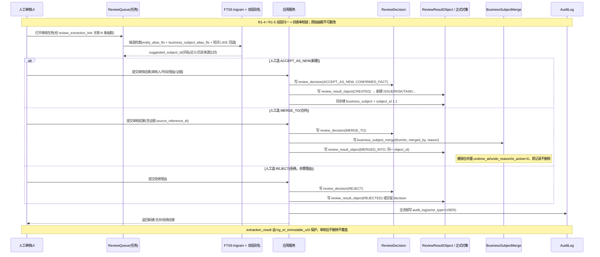

# Phase1.2 架构决策记录（ADR）

> 系统：EPCS Shipbuilding Intelligence　日期：2026-11-12　决策人：系统架构师（高见远）
> 本文档对本阶段开放问题 OQ-1~7 及 12 个架构问题给出**决策记录**（含方案对比与推荐），便于后续评审与变更跟踪。每个 ADR 格式：背景 / 方案 / 优缺点 / 推荐 / 状态。
> R1 整改同步：2026-11-12，以《Phase1.2_数据库表结构设计.md》(R1) 为唯一真值源

---

## ADR-1 项目/船舶/合同建模（架构问题 1）

- **背景**：B.1 产品已定"项目承载一艘主造对象、多合同靠 组织×角色 + 关联文档 表达；不强合同表"。OQ-1 遗留是否引入独立 Contract 强实体。
- **方案A（推荐·弱实体）**：项目承载主造对象（`project.main_object_entity_id→entity`）；合同事实用 `project_member(is_contract_carrier=1)` + `source_reference` 关联文档承载；不建 `contract` 表。未来若需合同强实体，可新增表并入 `project` 而不破坏现有结构。
- **方案B（强合同实体）**：独立 `contract` 表（合同号、甲方/乙方、金额、签署）。
  - 优点：合同维度强表达、可独立查询/审计。
  - 缺点：违背"不强实体"产品倾向、一期增加复杂度、合同与角色关系需再建模。
- **优点（A）**：贴合产品倾向；组织×角色三维本就承载合同；动态可扩展。
- **缺点（A）**：合同级专属字段（金额/份数）暂无处放——一期用 `project.contract_summary` + 文档/evidence 承载。
- **推荐**：**方案A（弱实体）**，`project_member.is_contract_carrier` 备好升级位。多船/船队经 `project↔entity`(M:N) 扩展，不封闭。
- **状态**：定。
- **R1 补充**：`project.main_object_entity_id → entity(id)` 与 `equipment.manufacturer_entity_id → entity(id)` 两处 FK 由原稿"注释后置/动态"改为**显式 `REFERENCES entity(id)`**（R1-6 逐项整改）；建表顺序相应把 `entity` 等基础表**前置**到域1 之前（SQLite 允许 FK 引用后置表，前移仅为可读性与向 PostgreSQL 迁移的依赖拓扑准备）。另新增 `department` 表与 `person.department_id`。

---

## ADR-2 EPCS 阶段与专业/区域/系统的关系（架构问题 2）

- **背景**：B.2 定 EPCS 为时间纵轴、专业/区域/系统为横坐标，正交、可并列，禁止 status 枚举锁死。OQ-5 问实现粒度（统一关联表 vs 分表）。
- **方案A（推荐·统一关联表）**：`object_dimension_tag` 一张表，`dimension ∈ {EPCS_PHASE, DISCIPLINE, AREA, SYSTEM}` + `value_id/value_text`。
  - 优点：统一接口、任意对象打任意多标签、自由值表达"阶段不确定/跨阶段"、FTS 命中统一；新增维度只加 dimension 枚举不动表。
  - 缺点：SQL 上对某一路维度查询需按 dimension 过滤；性能由 `idx_odt_dim(dimension,value_id)` 补偿。
- **方案B（分表）**：`issue_phase`/`issue_discipline`… 每对运行时建表。
  - 优点：查询直观。
  - 缺点：对象×维度无数组合、schema 爆炸、维护难。
- **推荐**：**方案A**。主维度允许放快捷列（如 `plan_activity.discipline_id`）提性能，副维度一律走 tag。
- **状态**：定（OQ-5 关闭为"统一关联表"）。
- **R1 补充**：`object_dimension_tag` 增 `CHECK(value_type IN ('REF','FREE_TEXT'))` 及 REF/FREE_TEXT 值互斥约束（`value_type='REF' → value_id IS NOT NULL AND value_text IS NULL`；`value_type='FREE_TEXT' → value_text IS NOT NULL AND value_id IS NULL`），修复原稿仅有 `dimension` CHECK、值类型可乱填的问题（R1-6 逐项整改，实测拦截非法行）。

---

## ADR-3 人员/组织/项目角色关联（架构问题 3）

- **背景**：Organization→Person 1:N；人员跨项目承担角色须可表达且不重复定义。
- **方案（定）**：`organization→person` 1:N；`project_member` = project×organization×person×role×valid_from，`UNIQUE` 防重复，`is_contract_carrier` 承载合同事实（ADR-1）。同人多项目多角色由多次 `project_member` 表达。用户/账号体系（`user`）Phase 后期启用，与 `person` 关联预留。
- **推荐**：此方案。`person_id` 可空以支持"组织级角色"。
- **状态**：定。
- **R1 补充**：`project_member` 删除表内 `UNIQUE(project_id, organization_id, person_id, role_name, valid_from)` —— SQLite 的 `UNIQUE` 视 NULL 互不相等，`person_id`/`valid_from` 可空时会插入重复组合（**NULL 唯一性漏洞**）；改用**表达式唯一索引** `uq_pm ON project_member(project_id, organization_id, COALESCE(person_id,''), role_name, COALESCE(valid_from,''))`（实测重复被拦截，R1-6 逐项整改）。

---

## ADR-4 "一问题多计划活动/邮件/会议/文件"多对多（架构问题 4，B.3）

- **背景**：Issue↔PlanActivity/Email/Meeting(Minutes)/Document/Drawing/Message/Evidence 全部 M:N，统一经引用桥，实现一页纸问题看板。
- **方案A（推荐·对象桥）**：`object_link(left_type,left_id / right_type,right_id, role, context_excerpt)`，M:N；来源承载走 `source_reference`。
  - 优点：一个桥覆盖全部业务对象间 M:N，schema 不膨胀；新增对象类型不改表。
  - 缺点：多态引用无硬 FK，需应用层+审计+摄入校验兜底。
- **方案B（每对建关联表）**：issue_activity/issue_email/issue_document…。
  - 缺点：组合爆炸、维护成本高，且"一文件被多引用"（B.4）会裂成多张。
- **推荐**：**方案A（`object_link`）**，配合 OQ-2 的合并链（ADR-6，R1 已修订为业务事项双层归一）。
- **状态**：定。
- **R1 补充**：`object_link` 等多态引用新增可执行自检策略 `sp_check_polymorphic_refs`（一组 UNION 查询，按 type 分派到目标表查孤儿，覆盖 `source_reference` / `object_link` / `evidence_link` / `decision_link` / `action_measure_link` / `review_result_object` / `business_subject_alias` / `object_dimension_tag`），**摄入作业完成后 + 定期执行，结果写 `audit_log`**。明确这是"应用层校验 + 自检 + 审计"三层补偿的**已知取舍**：多态字段无硬 FK，不伪装成数据库硬约束（R1-6 逐项整改）。

---

## ADR-5 "一个文件被多事项引用"多对多（架构问题 5，B.4）

- **背景**：文件/图纸只读事实源，被多个（问题/任务/决策/活动/风险/知识）同时引用，且引用带上下文摘录。
- **方案（定）**：`source_reference` 已含 `traced_entity + source + context_excerpt + locator`，即一文件被 N 个`traced_entity`引用（N 行 source_reference，source 同一）；文件端只读（`document.is_readonly=1`）+版本化，不可反向篡改。检索时按 `source_id` 反查可得引用方列表。
- **补充**：引用上下文摘录 `context_excerpt` 满足"引了哪段/哪图"回溯（B.4）。
- **推荐**：直接采用，不另建表。
- **状态**：定。
- **R1 补充**：`source_reference` 的 `traced_entity_type/id` 与 `source_type/id` 均为多态引用，纳入 `sp_check_polymorphic_refs` 自检（UNION 查询按 type 分派查孤儿，摄入后 + 定期执行，结果写 `audit_log`）；与 `object_link`、各 `*_link`（`evidence_link` / `decision_link` / `action_measure_link`）同属**"应用层 + 自检 + 审计"三层补偿的已知取舍**，多态字段无硬 FK、不伪装成数据库硬约束（R1-6 逐项整改，与 ADR-4 同一策略）。

---

## ADR-6 全局实体标识 + 合并机制防重复（架构问题 6，B.5 / OQ-2）

> **原结论作废**：原稿把「同一问题」的合并交给 `entity_relationship(synonym/merge)`，并写「`issue` 本身不直接自引用合并，一律经 `entity` 归一」——**混淆了业务实体**（设备/船舶/区域/组织/供应商等名词）**与业务事项**（Issue/Risk/Task/Decision/KnowledgeItem 等事件），导致 Issue 无别名、无来源证据链、无法撤销错误合并、合并后原记录语义丢失。R1 按双层归一重写本 ADR。

- **背景**：同一业务事项（如某问题）可能在邮件/会议/任务中重复出现；同时设备/船舶/组织等业务实体也需跨来源归一。二者语义不同，须**分层**处理，且合并链可逆、历史不丢。
- **方案（R1 定案·双层归一）**：
  1. **业务实体层**：`entity` + `entity_alias` + `entity_identifier` + `entity_relationship`，**只管**设备/船舶/区域/组织/供应商/专业等实体的语义关系与别名；**`entity_relationship` 不得承载业务事项合并**。
  2. **业务事项层**：`business_subject`（统一事项主档，`subject_kind` ∈ ISSUE/RISK/TASK/DECISION/KNOWLEDGE_ITEM）+ `business_subject_alias`（一事项多别名）+ `business_subject_merge`（**可逆合并链**）+ `business_subject_source`（事项↔来源证据 M:N，保留每次出现位置）。
  3. **1:1 挂载**：`issue/risk/task/decision/knowledge_item` 各增 `subject_id TEXT NOT NULL UNIQUE REFERENCES business_subject(id)`（1:1）。
  4. **可逆撤销**：撤销合并通过 `business_subject_merge.undone_at/undone_by/undo_reason/is_active=0` 实现，`from_subject.status` 由 MERGED 回 ACTIVE、`canonical_subject_id` 清空；**原业务记录不删除、不覆盖**，仅标 `status=MERGED` 并保留 canonical 指针，历史引用经 canonical 链全部可回放。
  5. **审核链**：`extraction_result`(AI_INFERENCE) → `review_extraction_link` → `review_queue`（`business_subject_alias_fts` 候选检索 + `source_reference` 比对）→ `review_decision`（人工，含审核人/时间/理由/证据）→ `review_result_object` → 正式对象或 `business_subject_merge`（详见 ADR-7 / R1-5）。
- **优点**：实体与事项语义分离；合并可逆、原始记录不丢；别名/来源/审核证据链完整；防重复（未经人工确认不落正式对象）。
- **缺点**：表数量增加（新增 `business_subject` 等 4 张 + 审核链 4 张）；多态引用需 `sp_check_polymorphic_refs` 自检（见 ADR-4/5 的已知取舍）。
- **推荐**：采用 R1 双层归一定案。
- **状态**：定（R1 修订）。**OQ-2 重新关闭**为该结论：业务实体 / 业务事项双层归一 + 可逆合并链 `business_subject_merge`；原「一律经 entity 归一、issue 不直接自引用合并」作废。

---

## ADR-7 AI 推断与人工事实分离（架构问题 7，B.8 / OQ-7）

> **原 FTS 结论作废**：原稿推荐「外部内容表 + 触发器同步」，且《核心实体数据字典》原 §7.2 写过 `content_rowid='id'`（TEXT UUID）。SQLite FTS5 外部内容表的 `content_rowid` **必须是整数 rowid**，TEXT UUID 无法映射（实测所有行被压成 rowid 0）；外部内容表 `count(*)` 读 content 表不反映索引，幽灵行只有 `integrity-check` 能发现；且要求列名与主表严格对应，旧草案 `document_fts(name,snapshot_json)` 等列根本不存在于被索引表。R1 改为统一普通内容表范式。

- **背景**：信息性质六层 G5 定案；AI 产出默认 `AI_INFERENCE` 进 ReviewQueue；FTS 中文检索须 trigram + 双层别名召回；审核链须完整可回放。
- **方案（R1 定案）**：
  1. `info_nature` 六枚举**全库强制**作基字段（`CHECK` + `system_config` 双轨，OQ-4）；`AI_INFERENCE/PREDICTION/PROPOSAL` 不得自动升级为正式事实，须经人工确认。
  2. **FTS 统一范式**：全库 24 张 `tokenize='trigram'` 虚表一律采用**普通内容表（contentful）+ `biz_id UNINDEXED` 显式业务 UUID 映射**（版本表另带 `owner_biz_id` 指向主对象）；**不再使用外部内容表**。业务表与 FTS 表一一对应（见《表结构设计》§7.2），**索引全部历史版本**，主表另建元数据 FTS；查询返回稳定 `biz_id` 再回业务表。
  3. **同步**：每张内容表 3 个触发器（`AFTER INSERT` / `AFTER UPDATE WHEN 文本字段变化` / `AFTER DELETE`），24×3 = **72** 个；UPDATE 采用「先 DELETE 旧 FTS 行再 INSERT 新行」避免 trigram 值漂移。
  4. **软删 / 重建 / 一致性**：软删**保留 FTS 行**，仅把 `is_deleted` 镜像置 1，查询统一带 `AND is_deleted=0` 并 JOIN 主表二次过滤；归档不改 FTS；支持全量重建（`DELETE FROM x_fts; INSERT INTO x_fts(...) SELECT ...`）与 4 项一致性自检（活跃行数差 / `biz_id` 孤儿 / 软删镜像一致 / trigram 正向自检）。
  5. **中文检索**：trigram 三字以上中文词正常命中；**1~2 字短词 MATCH 恒为 0**，须降级 **LIKE 回退**（限定项目/候选集 + `LIMIT`），并联合 `entity_alias_fts` / `business_subject_alias_fts` 双层别名表做短词等值召回；含 `-` `/` 等 FTS5 语法字符的查询词必须**整体双引号包裹**（`'"' + term.replace('"','""') + '"'`），否则报 `no such column` / `syntax error`。
  6. **审核链（R1-5）**：`extraction_result`(AI_INFERENCE) → `review_extraction_link`(M:N) → `review_queue`(纯审核任务) → `review_decision`(ACCEPT_AS_NEW / MERGE_TO / REJECT，含审核人/时间/理由/证据) → `review_result_object`(→正式对象稳定映射)；原始抽取由 `trg_er_immutable_u/d` 保护，审核后不得删除或覆盖。G5 链：`AI_INFERENCE → CONFIRMED_FACT → 正式对象 CONFIRMED_FACT`。
- **推荐**：`info_nature` 用 **`CHECK` + `system_config` 双轨**；FTS 用**统一普通内容表 + `biz_id` 显式映射 + 三向触发器 + 软删镜像 + LIKE 短词回退 + 双引号转义**。
- **状态**：定（R1 修订）。**OQ-7 重新关闭**为该结论；OQ-4 仍为双轨。

### ADR-7b FTS 同步策略（R1 修订）

| 方案 | 说明 | 结论 |
|---|---|---|
| 三向触发器即时同步（采用） | 24 张内容表 × INSERT/UPDATE/DELETE = **72** 个触发器，UPDATE 先删后插，查询最新 | ✅ **一期定案**：写入频率低、成本可忽略 |
| 摄入后批量重建 | `DELETE FROM x_fts` + `INSERT ... SELECT FROM 业务表` 全量重灌 | 作为**一致性修复与灾后重建**手段保留，接口 `rebuild_fts()`，不作日常同步 |
| 定时任务重建 | 依赖外部调度 | ❌ 一期不引 |

推荐：**三向触发器即时同步 + 摄入后 4 项一致性自检 + 可全量重建**；每次摄入后与定期维护运行 `sp_check_polymorphic_refs` 与 FTS 一致性检查，结果写 `audit_log`。原「外部内容表 + 触发器同步」结论作废。

---

## ADR-8 计划版本/批准基线/滚动预测共存（架构问题 8，B.7 / OQ-3）

> **原结论作废**：原稿把当前生效状态放在 `baseline_version.is_active` 上、用「`is_active` 部分唯一索引」保证一时一基线。四条致命缺陷：① `UNIQUE(plan_id,is_active)` 使一个计划**最多 2 条基线**（is_active 仅 0/1），违反「多个历史批准基线」；② 状态与内容同表，切换基线必须 `UPDATE baseline_version`，触发器一旦放行该 UPDATE 就无法阻止顺带改 `plan_version_id`/`approved_at` 等内容字段；③ 原触发器条件 `(NEW.is_active <> OLD.is_active) IS 0` 语义诡异且**放行所有含 is_active 变更的更新**；④ 切换无授权人、无审计。R1 改为状态分离。

- **背景**：Plan→PlanVersion 1:N；Plan→BaselineVersion 1:N（多个历史批准基线）；某一刻仅一个当前生效基线；滚动预测以多版本发布而非造表；批准基线内容真正只读、历史可回放。
- **方案（R1 定案）**：
  1. **删除** `UNIQUE(plan_id, is_active)` 与 `baseline_version.is_active` 字段；`baseline_version` 保留 `UNIQUE(plan_id,baseline_no)`，新增 `UNIQUE(plan_id,plan_version_id)`、`approved_at/approved_by/content_hash`、`is_readonly=1 CHECK(is_readonly=1)`。
  2. **状态分离**：新增 `plan_active_baseline(plan_id PK, baseline_version_id FK, is_active=1, switched_at, switched_by, authorization_ref, reason)` 作当前生效指针；部分唯一索引 `uq_pab_active ON plan_active_baseline(plan_id) WHERE is_active=1` 保证「同一计划最多一个当前生效基线」；新增 `baseline_switch_log` 记录每次切换的 from/to、授权人、时间、理由、audit_log_id。
  3. **无差别冻结**：`trg_bl_freeze_u BEFORE UPDATE ON baseline_version WHEN OLD.is_readonly=1 → RAISE(ABORT,'baseline frozen: content immutable')` 与 `trg_bl_freeze_d BEFORE DELETE ... → RAISE(ABORT,'baseline frozen: physical delete disabled')`，**不看任何字段**，杜绝通过改 is_active 绕过内容只读。
  4. **切换流程**（应用层单事务）：校验目标基线属于该 plan 且已批准 → 写 `baseline_switch_log` + `audit_log` → UPSERT `plan_active_baseline`；**全程不触碰 `baseline_version` 任何行**。
  5. **计划活动版本化（R1-2）**：`plan_activity` 降为稳定主实体；新增 `plan_activity_version`（每版本属性快照，`change_type` ∈ ADDED/MODIFIED/UNCHANGED/REMOVED，`UNIQUE(activity_id, plan_version_id)`）；`activity_dependency` 增 `plan_version_id`；`baseline_version.plan_version_id` 明确指向**完整计划版本**，故可按 `baseline → plan_version → plan_activity_version` 回放批准计划、做 V1/V2 差异对比、以及当前滚动预测 vs 批准基线对比。
  6. **AI 边界**：AI/自动化仅允许 INSERT `plan_version(is_forecast=1)`（`info_nature=PREDICTION`，**不能成为批准基线**）；`baseline_version` 的 INSERT 与切换要求 `actor_type='USER'` 且 `authorization_ref` 非空，并写 `audit_log`。
  7. **防御层次**：数据库层无差别冻结触发器 + 应用层写入白名单 + `plan_active_baseline` 状态分离 + `audit_log`/`baseline_switch_log` 审计，共**四层**（原 OQ-3「三重防御」细化）。
- **推荐**：采用 R1 状态分离方案。
- **状态**：定（R1 修订，OQ-3 重新关闭）。**六个基线测试案例全 PASS**（两条历史基线共存 / 第二条生效 / 第一条内容不可改 / 物理删除被阻止 / 同计划不能有两个生效基线 / 不同计划各有一个生效基线）；V1/V2 差异与历史回放实测 PASS。见《表结构设计》§2.4 / §2.5 / §8-C / §8-D。

---

## ADR-9 业务数据完整历史（架构问题 9，G4）

- **背景**：版本化+软删+历史回放；正式记录禁物理删除；成本可控。
- **方案A（推荐）**：版本容器（`*_version` + 内容 hash + snapshot_json 渐进）＋状态历史表＋软删（is_deleted/del_status）＋正式表禁物理删除触发器。快照先记录 `assets/` 资产引用，全量快照按需补。
  - 优点：历史完整可回放；一期成本可控。
  - 缺点：snapshot_json 全量 vs 增量需定（D.2 待人工确认成本边界）。
- **方案B（全量快照每版）**：历史最全但存储成本高、一期过度。**不采用**。
- **推荐**：**方案A**。
- **状态**：定（快照粒度 D.2-6 待确认）。
- **R1 补充**：版本容器新增 `plan_activity_version`（每计划版本的活动属性快照，`change_type` 四值），并新增 `baseline_switch_log` 承载基线切换全历史（R1-1/R1-2）；`document_version` / `drawing_version` / `meeting_minutes` / `knowledge_version` / `plan_activity_version` **全部历史版本**入 FTS（不只当前版本）。明确区分「文件 / 计划版本」与「业务事项版本」：后者由 `business_subject` + 状态历史 + 可逆 `business_subject_merge` 承载（见 ADR-6），二者不混用同一套版本容器。

---

## ADR-10 DWG 图纸对象预留（架构问题 10）

- **背景**：未来 DWG 解析涉及图纸↔设备/区域/系统/问题关联；本阶段**不装 SDK、不解析**，仅预留结构。
- **方案（定）**：`drawing(+drawing_version)` 已承载图纸与 revision；`drawing_object` 预留 DWG 对象表：`obj_type / ref_entity_id / ref_area_id / ref_system_id / geometry_json(占位) / reserved_data`。未来装 SDK 后只填字段，不改 schema。
- **关联预留**：`drawing` 已可经 `source_reference`/`object_link` 与 issue/equipment 等关联；`drawing_object.ref_entity_id→entity` 即设备/部位归一。
- **推荐**：直接采用；不引入 SDK、不引外部坐标格式假定。
- **状态**：定（DWG SDK 选型属后续 Phase，另行审批）。

---

## ADR-11 事项跨 E/P/C/S 阶段跟踪（架构问题 11，B.2）

- **背景**：一个对象（问题/风险/决策…）在建造推进中横跨多个 EPCS 阶段，且阶段可与专业/区域/系统并列，允许"阶段不确定/跨阶段"。
- **方案（定）**：对象挂 `object_dimension_tag(dimension=EPCS_PHASE, value_id 或 value_text="不确定/跨阶段")` **追加式**表达——对象生命周期跨阶段以标签累积呈现，而非把阶段做成会覆盖的 status。查询"当前处于哪些阶段"= 过滤该对象的最新 tag 集；历史跨阶段由 tag 时间戳回放。
- **补充**：`project_phase` 记录项目级 EPCS 实例，全局阶段目录由 `system_config`/dimension 归口，不硬编码。
- **推荐**：直接采用（与 ADR-2 同机制）。
- **状态**：定。

---

## ADR-12 避免旧库硬编码与固定目录（架构问题 12，G1/G3/G7）

- **背景**：旧库存在硬编码船名/项目/专业、固定目录问题；本系统全新建模，G3 严格隔离。
- **方案（定）**：
  - 一切维度值（船型/项目/专业/区域/系统/角色/枚举）入**维度表或 `system_config`**，ID 引用，杜绝字面值（G7）。
  - 外部自然编号统一入 `entity_identifier`（id_type/source_from/identifier）+ `EntityAlias`（简称/译名），不写死。
  - 原始资料 `02_Original_References` 只读归档，不复制旧结构、不引旧脚本/旧库（G3 表）。
  - 全库 Schema 由唯一 `migrations` 管理，永不经手工改库。
- **推荐**：此方案即"全链维度化 + 只读来源 + 唯一 schema 源"。
- **状态**：定。
- **R1 补充**：`entity_identifier` 唯一范围由全局 `UNIQUE(id_type, identifier)` **收敛**为 `UNIQUE(entity_id, id_type, COALESCE(source_from,''), identifier)`（同一实体/类型/来源下唯一，另建 `(id_type, identifier)` 非唯一检索索引），避免不同来源系统同号即冲突；`drawing_no` 唯一范围由全局 `UNIQUE(drawing_no)` **收敛**为按 `COALESCE(project_id,'')` 的表达式唯一索引（不同项目可同图号）；新增 `department` 维度表（与 `organization.parent_id` 上下级单位职责分离）；全库统一 `uuid4().hex` + `CHECK(length(id)=32 AND id NOT GLOB '*[^0-9a-f]*')`（R1-6 逐项整改）。

---

## 类图与程序调用流（架构层，R1 重绘）

### 类图（数据模型核心类）

```mermaid
classDiagram
    class Project { +id: UUID +project_code: str +main_object_entity_id: UUID +status: str }
    class ProjectPhase { +phase_code: str +seq_no: int }
    class Organization { +org_code: str +name: str }
    class Department { +code: str +name: str +parent_id: UUID }
    class Person { +name: str }
    class ProjectMember { +role_name: str +is_contract_carrier: bool }
    class Equipment { +name: str +manufacturer_entity_id: UUID }
    class Plan { +name: str +level: str }
    class PlanVersion { +version_no: str +is_forecast: bool }
    class BaselineVersion { +baseline_no: str +is_readonly: bool +content_hash: str }
    class PlanActiveBaseline { +plan_id: UUID +baseline_version_id: UUID +authorization_ref: str }
    class BaselineSwitchLog { +from_baseline_id: UUID +to_baseline_id: UUID +switched_by: UUID }
    class PlanActivity { +code: str +first_version_id: UUID }
    class PlanActivityVersion { +change_type: str +planned_start: str +planned_end: str }
    class ProgressRecord { +progress_pct: float }
    class BusinessSubject { +subject_kind: str +status: str +canonical_subject_id: UUID }
    class BusinessSubjectAlias { +alias: str +confirm_status: str }
    class BusinessSubjectMerge { +from_subject_id: UUID +to_subject_id: UUID +undone_at: str }
    class BusinessSubjectSource { +source_reference_id: UUID }
    class Issue { +ref_no: str +status: str +subject_id: UUID }
    class IssueStatusHistory { +new_status: str +reopen_count: int }
    class Risk { +ref_no: str +strategy: str +subject_id: UUID }
    class Task { +ref_no: str +subject_id: UUID }
    class Decision { +conclusion: str +subject_id: UUID }
    class KnowledgeItem { +title: str +subject_id: UUID }
    class ActionMeasure { +measure_type: str }
    class SourceReference { +traced_entity_type: str +source_type: str +context_excerpt: str }
    class Evidence { +title: str +sha256: str }
    class ObjectLink { +link_role: str +right_type: str }
    class ObjectDimensionTag { +dimension: str +value_type: str }
    class Entity { +name: str +entity_kind: str +status: str }
    class EntityAlias { +alias: str }
    class EntityIdentifier { +id_type: str +identifier: str }
    class EntityRelationship { +relation_type: str }
    class KnowledgeVersion { +content_md: str }
    class IngestionJob { +source_type: str +status: str }
    class ExtractionResult { +candidate_type: str +confidence: float }
    class ReviewQueue { +review_type: str +status: str +candidate_summary: str }
    class ReviewExtractionLink { +review_queue_id: UUID +extraction_result_id: UUID }
    class ReviewDecision { +decision: str +reviewer_person_id: UUID +reason: str }
    class ReviewResultObject { +object_type: str +object_id: UUID +relation: str }
    class AuditLog { +actor_type: str +action_code: str }

    Project "1" --> "0..*" ProjectPhase
    Project "1" --> "0..*" ProjectMember
    Organization "1" --> "0..*" Department
    Organization "1" --> "0..*" Person
    Department "1" --> "0..*" Person
    Department "1" --> "0..*" Department : parent
    Organization "1" --> "0..*" ProjectMember
    Project "1" --> "0..*" Plan
    Plan "1" --> "0..*" PlanVersion
    Plan "1" --> "0..*" BaselineVersion
    Plan "1" --> "0..*" PlanActiveBaseline
    Plan "1" --> "0..*" BaselineSwitchLog
    BaselineVersion "1" --> "0..1" PlanActiveBaseline : points
    PlanVersion "1" --> "0..*" PlanActivityVersion
    PlanActivity "1" --> "0..*" PlanActivityVersion
    PlanActivity "1" --> "0..*" ProgressRecord
    BusinessSubject "1" --> "0..*" BusinessSubjectAlias
    BusinessSubject "1" --> "0..*" BusinessSubjectMerge : from_or_to
    BusinessSubject "1" --> "0..*" BusinessSubjectSource
    BusinessSubject "0..1" --> "0..1" BusinessSubject : canonical
    BusinessSubject "1" --> "0..1" Issue : "1:1 subject_id"
    BusinessSubject "1" --> "0..1" Risk : "1:1 subject_id"
    BusinessSubject "1" --> "0..1" Task : "1:1 subject_id"
    BusinessSubject "1" --> "0..1" Decision : "1:1 subject_id"
    BusinessSubject "1" --> "0..1" KnowledgeItem : "1:1 subject_id"
    Project "1" --> "0..*" Issue
    Issue "1" --> "0..*" IssueStatusHistory
    Project "1" --> "0..*" Risk
    Project "1" --> "0..*" Task
    Entity "1" ..> "0..*" EntityAlias : has
    Entity "1" ..> "0..*" EntityIdentifier : has
    Entity "1" --> "0..*" EntityRelationship : "entity-only"
    Entity "0..1" --> "0..1" Entity : canonical_merge_entities_only
    KnowledgeItem "1" --> "0..*" KnowledgeVersion
    IngestionJob "1" --> "0..*" ExtractionResult
    ReviewQueue "1" --> "0..*" ReviewExtractionLink
    ExtractionResult "1" --> "0..*" ReviewExtractionLink
    ReviewQueue "1" --> "0..*" ReviewDecision
    ReviewDecision "1" --> "0..*" ReviewResultObject
    SourceReference ..> Entity : traces(M:N)
    ObjectLink ..> Entity : relates(M:N)
    ObjectDimensionTag ..> Entity : tags(M:N)
```

> 注：`ReviewQueue` 为**纯审核任务表**，已去掉 `decision` / `target_entity_id`；`ExtractionResult` 与 `ReviewQueue` 之间不再直连，改经 `ReviewExtractionLink` 的 M:N。`Entity` 自关联只表达**业务实体**归一，业务事项合并一律走 `BusinessSubjectMerge`。

### 程序调用流（摄入 → 审核 → 正式对象，R1 四表链）



---

## 未采纳备选与后续开关

- 独立 `contract` 表：一期不用，ADR-1 备升级位。
- 每对 M:N 独立关联表：不采用，统一 `object_link`（ADR-4）。
- G5 枚举纯 check 或纯 config：采用**双轨**（ADR-7）。
- DWG SDK：本阶段不装（ADR-10），后续 Phase 另行审批。

---

## R1 整改对 ADR 的影响汇总（2026-11-12）

| ADR | 修订性质 | 要点 | 对应整改 |
|---|---|---|---|
| ADR-1 | 补充 | `project.main_object_entity_id` / `equipment.manufacturer_entity_id` 显式 FK；新增 `department`；`entity` 前置建表 | R1-6 |
| ADR-2 | 补充 | `object_dimension_tag.value_type` CHECK(REF/FREE_TEXT) + 值互斥 | R1-6 |
| ADR-3 | 补充 | `project_member` 改 `COALESCE` 表达式唯一索引，修复 NULL 唯一性漏洞 | R1-6 |
| ADR-4 | 补充 | `object_link` 纳入 `sp_check_polymorphic_refs` 多态孤儿自检（应用层 + 自检 + 审计三层补偿，已知取舍） | R1-6 |
| ADR-5 | 补充 | `source_reference` 多态引用纳入同一自检策略 | R1-6 |
| **ADR-6** | **整段重写（原结论作废）** | 业务实体 / 业务事项双层归一；`business_subject` 四表；可逆合并；`entity_relationship` 不得承载事项合并；OQ-2 重新关闭 | **R1-4** |
| **ADR-7 / ADR-7b** | **整段重写（原 FTS 结论作废）** | 统一普通内容表 + `biz_id UNINDEXED`；24 张 FTS 一一对应；三向触发器 72；软删镜像；短词 LIKE 回退；双引号转义；审核四表链；OQ-7 重新关闭 | **R1-3 / R1-5** |
| **ADR-8** | **整段重写（原结论作废）** | 删除 `UNIQUE(plan_id,is_active)`；状态分离 `plan_active_baseline` + `baseline_switch_log`；无差别冻结；`plan_activity_version` 逐版本快照；四层防御；OQ-3 重新关闭 | **R1-1 / R1-2** |
| ADR-9 | 补充 | `plan_activity_version` 与 `baseline_switch_log` 两类历史；全部历史版本入 FTS；区分「文件 / 计划版本」与「业务事项版本」 | R1-2 / R1-3 |
| ADR-10 / ADR-11 | 不变 | DWG 不装 SDK、阶段标签追加式，R1 未涉及 | — |
| ADR-12 | 补充 | `entity_identifier` / `drawing_no` 唯一范围收敛；新增 `department`；UUID CHECK | R1-6 |

> 8 份文档统一统计口径：实体表 **75**（业务主表 46 + 辅助 29）、FTS5 虚表 **24**、触发器 **96**、视图 **0**，见《Phase1.2_数据库表结构设计.md》§0.2。本轮修订的完整「原设计 → 评审问题 → 方案对比 → 修改后设计 → ADR 影响」见《Phase1.2_架构评审整改记录.md》。

## R1 整改同步说明

1. 保留 ADR-1~5、ADR-9~12 的原始背景、方案对比与优缺点，仅追加「R1 补充」条目。
2. ADR-6 / ADR-7 / ADR-7b / ADR-8 因原结论存在**建表阻断问题**，整段重写并在开头标注「原结论作废」。
3. 类图与时序图按 R1 的 75 张表与四表审核链重绘：删除 `ExtractionResult → ReviewQueue` 直连，改为经 `ReviewExtractionLink` 的 M:N；`BaselineVersion` 去掉 `is_active`；新增 `PlanActiveBaseline` / `BaselineSwitchLog` / `PlanActivityVersion` / `Department` / `BusinessSubject*` / `Review*` 等类。
4. 新增「R1 整改对 ADR 的影响汇总」表，与《架构评审整改记录》§0 总览一致。
